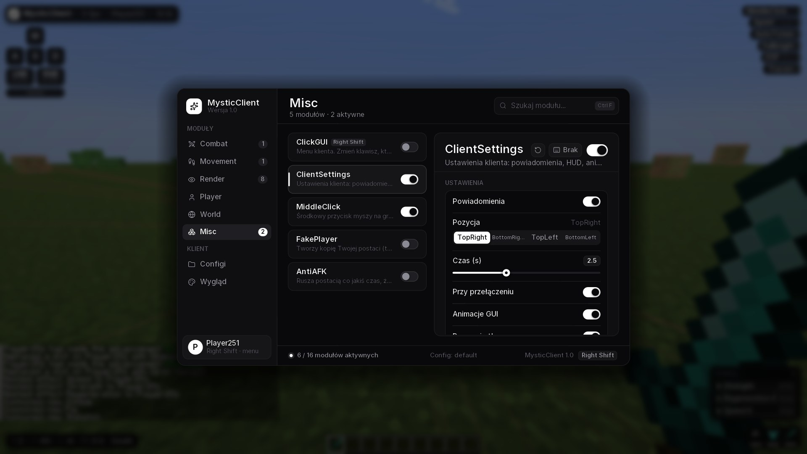
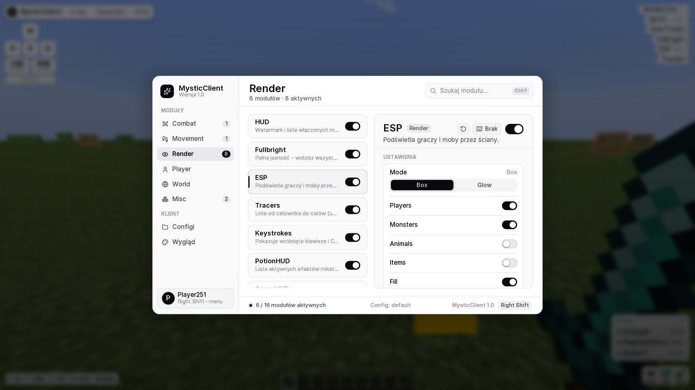
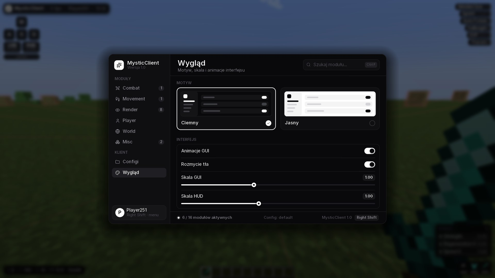
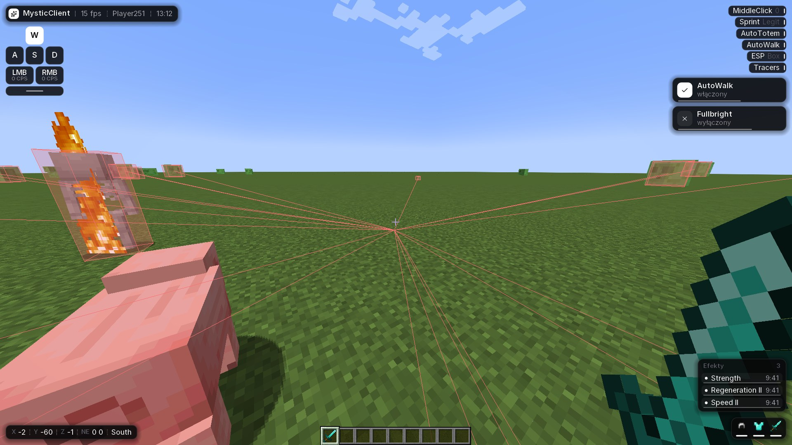
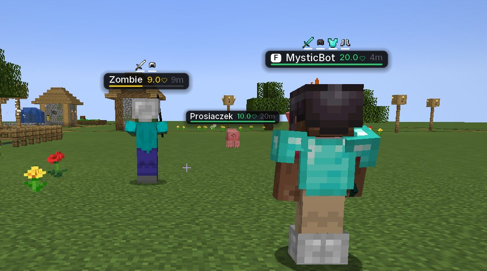

# ✦ MysticClient

Klient do Minecrafta **1.21.4** (Fabric) z nowoczesnym, czarno-białym ClickGUI, HUD-em i modułami.



| Jasny motyw | Wygląd | HUD |
|---|---|---|
|  |  |  |

**NameTags** – tabliczki z HP, paskiem zdrowia, dystansem, zbroją i oznaczeniem znajomego:



## Instalacja (krok po kroku)

1. Zainstaluj **Fabric Loader** dla Minecraft **1.21.4**: <https://fabricmc.net/use/installer/>
2. Pobierz **Fabric API** dla 1.21.4: <https://modrinth.com/mod/fabric-api> (wersja `0.119.x+1.21.4`).
3. Wrzuć do folderu `.minecraft/mods`:
   - `Fabric API`
   - `download/MysticClient-1.0.0.jar` (z tego folderu)
4. Uruchom Minecrafta z profilem **Fabric 1.21.4**.
5. W grze naciśnij **Right Shift**, żeby otworzyć menu.

> Folder `.minecraft` na Windowsie: wciśnij `Win + R` i wpisz `%appdata%\.minecraft`.

## Sterowanie w menu

| Akcja | Jak |
|---|---|
| Otwórz / zamknij menu | `Right Shift` (zmienisz w module ClickGUI) |
| Włącz / wyłącz moduł | przełącznik albo **PPM** na module |
| Ustaw klawisz modułu | **ŚPM** na module albo przycisk z klawiaturą → naciśnij klawisz (`Esc` / `Backspace` = usuń) |
| Szukaj | kliknij wyszukiwarkę albo `Ctrl + F` |
| Znajomy | z włączonym **MiddleClick**: środkowy przycisk myszy na graczu |

## Moduły

| Kategoria | Moduły |
|---|---|
| Combat | KillAura (Single/Switch/Multi + Target ESP), TriggerBot, AutoTotem |
| Movement | Sprint (Legit/Omni), AutoWalk, SafeWalk |
| Render | NameTags, HUD (watermark + ArrayList), Fullbright, ESP (Box/Glow), Tracers, Keystrokes, PotionHUD, ArmorHUD, Coordinates |
| Player | AutoRespawn, FastPlace, AutoEat |
| World | NoWeather, TimeChanger |
| Misc | ClickGUI, ClientSettings, MiddleClick, FakePlayer, AntiAFK |

Configi zapisują się w `.minecraft/config/mysticclient/` (zakładka **Configi** w menu).

> Używaj na swoich światach / serwerach, które na to pozwalają – na większości serwerów cheaty są zabronione i grozi za nie ban.

## Budowanie ze źródeł

Wymagana Java 21.

```bash
cd MysticClient
./gradlew build          # gotowy plik: build/libs/MysticClient-1.0.0.jar
./gradlew runClient      # uruchamia grę z modem do testów
```

### Struktura kodu

```
src/main/java/pl/mysticclient/
├── MysticClient.java        – start moda, eventy (tick, HUD, render 3D)
├── module/                  – moduły (każdy w swojej kategorii) + ModuleManager
├── setting/                 – ustawienia: Bool / Number / Mode
├── gui/ClickGuiScreen.java  – menu
├── util/UI.java             – renderer: wygładzone kształty, cienie, czcionka Inter, ikony
├── util/Theme.java          – kolory (ciemny / jasny)
├── config/                  – zapis/odczyt configów (JSON)
└── mixin/                   – haki do kodu Minecrafta
```

Nowy moduł = nowa klasa dziedzicząca po `Module` + jedna linijka `register(...)` w `ModuleManager`.

## Licencje czcionek

- Czcionka **Inter** – SIL Open Font License 1.1 (`licenses/Inter-OFL.txt`)
- Ikony **Lucide** – ISC (`licenses/Lucide-ISC.txt`)
