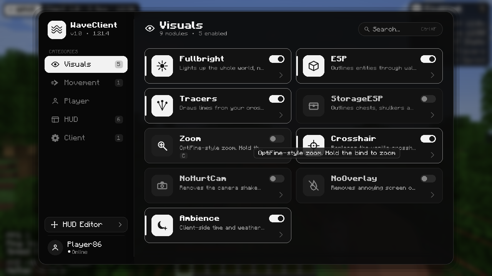
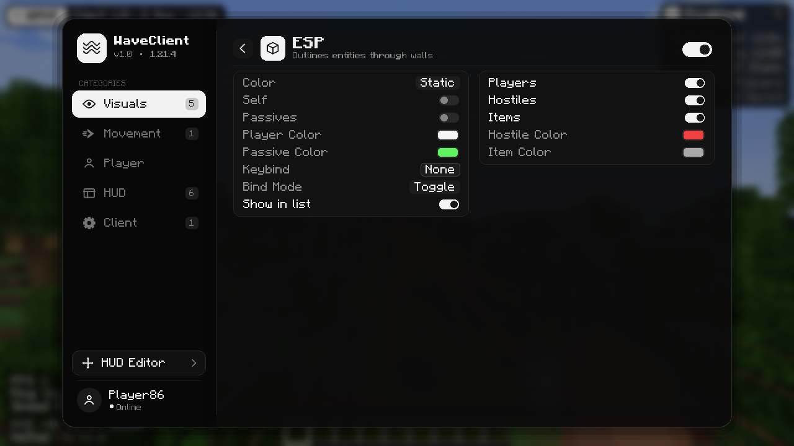

# 🌊 WaveClient

Klient-mod do **Minecraft 1.21.4 (Fabric)** z rozbudowanym, animowanym ClickGUI w stylu czarno-białym, systemem bindów, edytorem HUD, powiadomieniami i modułami wizualnymi.





## ✦ Instalacja
1. Zainstaluj **Fabric Loader** dla 1.21.4 (<https://fabricmc.net/use/installer/>).
2. Wrzuć do `.minecraft/mods`:
   - `WaveClient-1.0.0.jar` (z `build/libs/` po zbudowaniu),
   - **Fabric API** dla 1.21.4.
3. Uruchom grę z profilem Fabric.

### Budowanie
```bash
cd WaveClient
./gradlew build          # gotowy plik: build/libs/WaveClient-1.0.0.jar
./gradlew runClient      # uruchomienie gry w trybie deweloperskim
```
Wymaga Javy 21.

## ✦ Sterowanie
| Klawisz / akcja | Działanie |
|---|---|
| **Prawy Shift** | Otwiera / zamyka ClickGUI |
| Klik w kategorię (lub ↑ / ↓) | Zmiana kategorii w panelu bocznym |
| **LPM** na karcie modułu | Włącza / wyłącza moduł |
| **PPM** na karcie lub strzałka `>` | Otwiera stronę ustawień modułu |
| `Esc` / przycisk `<` | Powrót z ustawień |
| Pisanie / `Ctrl+F` | Wyszukiwarka (Enter otwiera ustawienia jedynego wyniku) |
| Przeciąganie logo / nagłówka | Przesuwa okno GUI |
| Kółko myszy | Przewijanie / zmiana wartości suwaka |
| **PPM** na suwaku | Reset do wartości domyślnej |
| **C** (przytrzymaj) | Zoom (kółkiem zmieniasz przybliżenie) |

### System bindów
- W ustawieniach każdego modułu jest pole **Keybind**: kliknij → naciśnij klawisz (lub boczny przycisk myszy MB3–MB5).
- `Esc` / `Backspace` / `Delete` / PPM — usuwa bind.
- **Bind Mode**: `Toggle` (przełącz) lub `Hold` (aktywny tylko podczas trzymania).
- Bind jest wyświetlany obok nazwy modułu w GUI.

## ✦ GUI
- Jedno okno w stylu czarno-białym: panel boczny z kategoriami (własne ikony, animowany wskaźnik, licznik włączonych), siatka kart modułów i osobna strona ustawień w dwóch kolumnach.
- **Własne ikony** dla każdej kategorii i każdego modułu (atlas generowany skryptem `tools/gen_icons.py`).
- Karta modułu: kafelek z ikoną (podświetla się po włączeniu), nazwa, opis, przełącznik, bind, przejście do ustawień.
- Animacje: otwierania okna (Scale / Slide / Fade), kart wjeżdżających po kolei przy zmianie kategorii, przejścia siatka ↔ ustawienia, przełączników, suwaków, list trybów, hover, pasek przewijania z wygaszaniem krawędzi, podpowiedzi przy kursorze.
- Kolor akcentu do zmiany (**ClickGUI → Accent**, także Rainbow), rozmycie tła, dźwięki.
- Pozycja okna, wybrana kategoria i wszystkie ustawienia zapisują się w `.minecraft/config/waveclient.json`.

## ✦ Powiadomienia
Przy włączeniu / wyłączeniu modułu wysuwa się czarna karta z ikoną modułu, nazwą, animowanym mini-przełącznikiem i paskiem czasu. Pozycja (BottomRight / TopRight / TopCenter), czas i dźwięk w module **Notifications**.

## ✦ HUD (edytor: przycisk „HUD Editor” na dole GUI)
Przeciągaj elementy myszką, przyciąganie do krawędzi, środka i innych elementów z liniami pomocniczymi, siatka. Kliknięcie „chipa” włącza/wyłącza element, PPM na elemencie go ukrywa.

| Element | Opis |
|---|---|
| Watermark | Logo klienta (style Modern / Minimal / Logo), FPS, godzina, nick |
| ArrayList | Karta z ikonką i nagłówkiem **Enabled:** (licznik), pod spodem włączone moduły z ikonami i animacją; styl Classic do wyboru |
| Info | FPS, ping, prędkość (b/s), serwer, biom |
| Coordinates | XYZ, kierunek, przeliczenie Nether/Overworld |
| Armor | Zbroja + przedmioty w rękach z % wytrzymałości |
| Potions | Aktywne efekty z czasem |
| Keystrokes | WASD, LPM/PPM z CPS, spacja (animowane) |
| Inventory | Podgląd ekwipunku |

## ✦ Moduły
**Visuals:** Fullbright, ESP (gracze/moby/zwierzęta/itemy, kolory Static/Rainbow/Health/Team), Tracers, StorageESP (skrzynie, ender, shulkery, beczki), Zoom, Crosshair (własny celownik), NoHurtCam, NoOverlay (ogień, woda), Ambience (czas i pogoda po stronie klienta).

**Movement:** Sprint, AutoWalk, Parkour, Eagle.

**Player:** AutoRespawn, AntiAFK.

**Client:** ClickGUI, Notifications, HUD Editor.

> ⚠️ Używaj na własnych światach lub serwerach, które na to pozwalają — na wielu serwerach takie modyfikacje są zabronione regulaminem.
