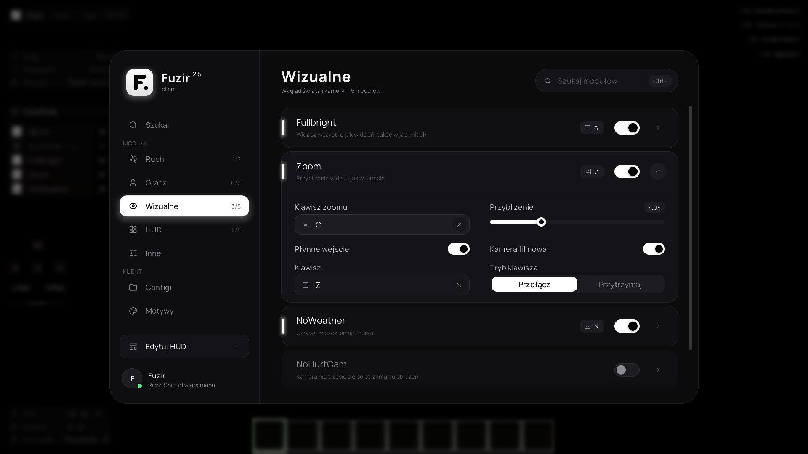
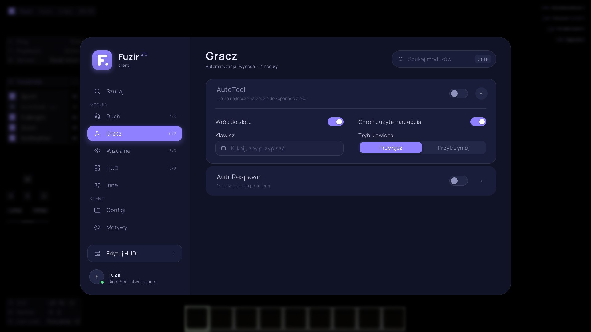
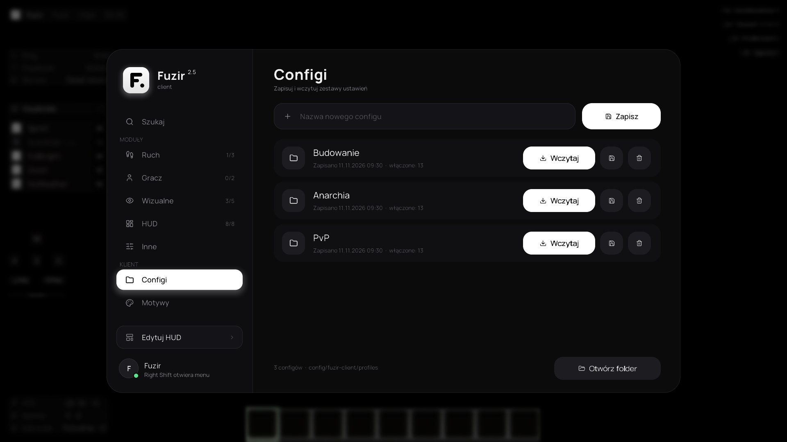
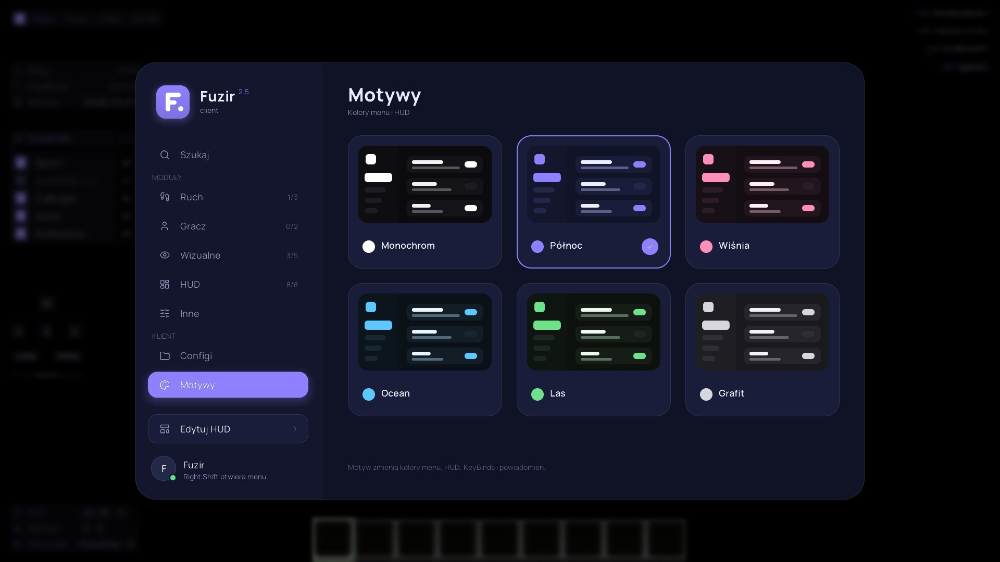
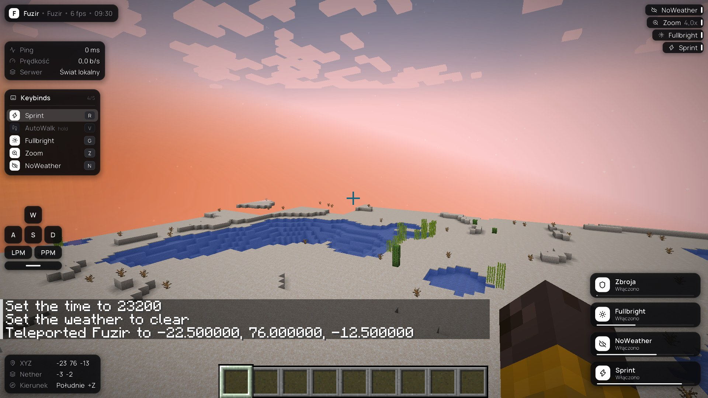
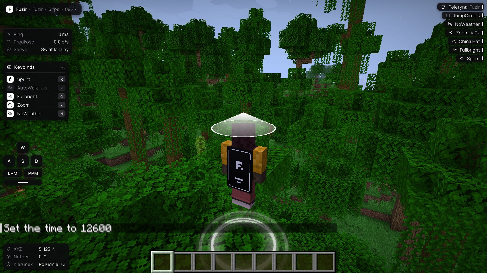

# Fuzir Client 2.6

Klient do Minecrafta 1.21.4 (Fabric) z dużym, nowoczesnym ClickGUI, motywami, configami, panelem KeyBinds i przesuwanym HUD.













## Co jest w środku

- **Gładka grafika**: każdy kształt rysuje własny shader GPU (`shaders/core/rounded`). Krawędzie są wygładzone, cienie miękkie, a skala dopasowuje się do rozdzielczości.
- **Logo projektu** zbudowane z wektorowych kształtów w kolorze motywu. Tekst jest w czcionce Manrope, a ikony nawigacji z Lucide.
- **Menu**: panel boczny ze stronami (Szukaj, Ruch, Gracz, Wizualne, HUD, Inne, Configi, Motywy) i przesuwanym podświetleniem. Lista modułów pokazuje nazwę i opis, a ustawienia rozwijają się w dwóch kolumnach przy module (strzałka obraca się).
- **Szukaj**: wyszukiwanie po nazwie, opisie i kategorii, z etykietą kategorii przy każdym wyniku.
- **Configi**: zapis obecnych ustawień pod nazwą, wczytywanie, nadpisywanie i usuwanie (z potwierdzeniem), a także otwieranie folderu.
- **Motywy**: Monochrom, Północ, Wiśnia, Ocean, Las i Grafit z podglądem. Przejście między kolorami jest płynne i obejmuje menu, HUD, KeyBinds i powiadomienia.
- **Powiadomienia**: mały czarny embed `ikonka | Nazwa | Enabled/Disabled` z paskiem czasu.
- **KeyBinds na ekranie**: wiersze `ikona | nazwa | klawisz`. Po wciśnięciu klawisza wiersz błyska. Tryb klawisza: przełącz albo przytrzymaj.
- **Edytor HUD**: przeciąganie elementów, przyciąganie do krawędzi i środka ekranu, reset pozycji.

## Instalacja

1. Zainstaluj [Fabric Loader](https://fabricmc.net/use/installer/) dla wersji **1.21.4**.
2. Wrzuć do folderu `.minecraft/mods`:
   - `fuzir-client-2.6.0.jar` (gotowy w folderze `release`),
   - [Fabric API](https://modrinth.com/mod/fabric-api) dla 1.21.4.
3. Uruchom grę z profilem Fabric.

## Sterowanie

| Klawisz | Akcja |
|---|---|
| Prawy Shift | otwiera / zamyka menu (zmienisz w Opcje → Sterowanie → Fuzir Client) |
| Klik na karcie | włącza / wyłącza moduł |
| Prawy klik albo ikona zębatki | otwiera ustawienia modułu |
| Pisanie w menu / Ctrl+F | wyszukiwanie, Enter włącza jedyny wynik |
| Strzałki ↑ ↓ | zmiana kategorii |
| Esc | zamyka panel ustawień, wyszukiwanie albo menu |
| Pole klawisza | kliknij i wciśnij klawisz; Esc / Backspace / krzyżyk usuwa |

Ustawienia, klawisze i pozycje HUD zapisują się w `.minecraft/config/fuzir-client.json`.

## Moduły

| Kategoria | Moduł | Co robi |
|---|---|---|
| Ruch | Sprint | bieganie bez trzymania klawisza |
| Ruch | ToggleSneak | kucanie bez trzymania klawisza |
| Ruch | AutoWalk | chodzenie do przodu, wypływanie w wodzie |
| Gracz | AutoTool | najlepsze narzędzie z paska do kopanego bloku, ochrona zużytych narzędzi |
| Gracz | AutoRespawn | odrodzenie po śmierci z ustawianym opóźnieniem |
| Wizualne | Fullbright | pełna jasność |
| Wizualne | Zoom | płynne przybliżenie pod klawiszem C |
| Wizualne | NoWeather | bez deszczu i burzy |
| Wizualne | NoHurtCam | kamera nie trzęsie się po obrażeniach |
| Wizualne | NoFireOverlay | ogień nie zasłania ekranu |
| Wizualne | Peleryna | własna peleryna HD z logo Fuzir (Fuzir, Monochrom, Północ, Zachód), także na elytrze; widoczna tylko u Ciebie |
| Wizualne | JumpCircles | rozchodzące się kręgi pod nogami przy skoku i lądowaniu (motyw, biały, tęcza) |
| Wizualne | China Hat | półprzezroczysty stożek nad głową w widoku z trzeciej osoby |
| HUD | Watermark, KeyBinds, Lista modułów, Informacje, Koordynaty, Klawisze, Zbroja, Powiadomienia | elementy na ekranie |
| Inne | Menu | rozmycie, dźwięki, opisy, szybkość animacji, skala menu i HUD |

## Budowanie

Wymaga JDK 21.

```
./gradlew build
```

Gotowy plik: `build/libs/fuzir-client-2.6.0.jar`.

`./gradlew runAutotest` uruchamia grę z modułem testowym (`src/testmod`), który sam tworzy świat, przechodzi przez menu i zapisuje zrzuty ekranu do `run/screenshots`. Moduł testowy nie trafia do jara.

## Dodawanie modułu

1. Klasa w `src/main/java/tech/fuzir/client/module/impl`, dziedzicząca po `Module` (albo `HudModule` dla elementu HUD).
2. Ikona: stała z `util/Icons` (nowe ikony trzeba dodać do `font/lucide.ttf`).
3. Ustawienia przez `add(new BoolSetting(...))`, `NumberSetting`, `ModeSetting`, `KeySetting`; menu rysuje je samo.
4. Logika w `onTick()`, `onEnable()`, `onDisable()`; rejestracja w `ModuleManager.init()`.

Czcionki: [Manrope](https://github.com/sharanda/manrope) (SIL Open Font License 1.1), ikony: [Lucide](https://lucide.dev) (ISC).
