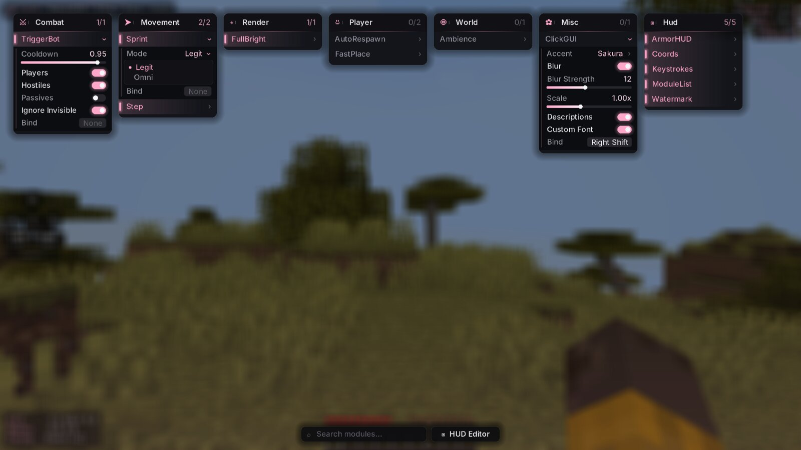
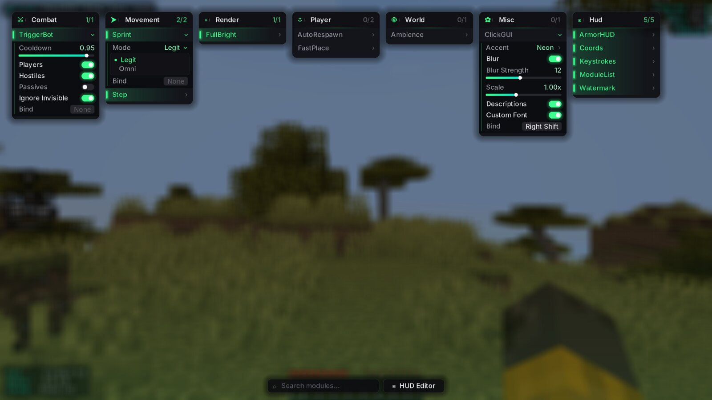
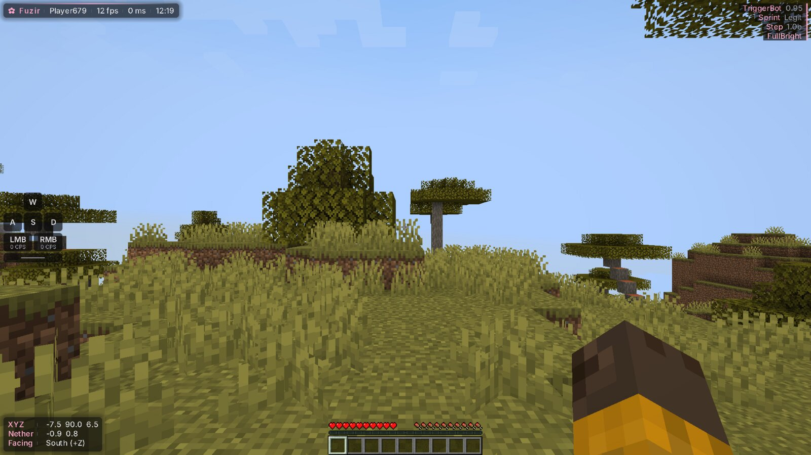

# Fuzir Client

Klient utility dla **Minecraft 1.20.1 (Fabric)**: szklany ClickGUI w stylu Sakura oraz edytor HUD z przeciąganiem i przyciąganiem do krawędzi.

| Sakura | Neon |
| --- | --- |
|  |  |



## Budowanie i uruchomienie

```bash
./gradlew build        # jar trafia do build/libs/fuzir-client-1.0.0.jar
./gradlew runClient    # klient deweloperski
```

Wymagania: Java 17+, Fabric Loader ≥ 0.15 i Fabric API.

## Sterowanie

| Gdzie | Akcja |
| --- | --- |
| W grze | **Right Shift** otwiera ClickGUI (zmienisz to w Misc → ClickGUI → Bind) |
| Nagłówek panelu | LPM i przeciągnięcie przesuwa panel, PPM zwija / rozwija |
| Moduł | LPM włącza / wyłącza, PPM rozwija ustawienia |
| Suwak | Przeciąganie ustawia wartość, **Shift + przeciąganie** to tryb precyzyjny (10% prędkości), strzałki zmieniają o jeden krok, PPM resetuje |
| Tryb | LPM otwiera listę, PPM przełącza na następny |
| Bind | LPM zaczyna nasłuchiwanie, ESC anuluje, Delete / Backspace / PPM usuwa przypisanie |
| Dowolny klawisz znakowy | Wyszukiwanie modułów |
| Ctrl + kółko | Skalowanie całego GUI |
| Przycisk *HUD Editor* | Edytor HUD: przeciąganie z przyciąganiem (Alt wyłącza przyciąganie), PPM włącza / wyłącza element, strzałki przesuwają o 1px (Shift: o 10px), ESC wraca |

Ustawienia, bindy, pozycje HUD i układ paneli zapisują się do `config/fuzir/config.json`.

## Architektura (`tech.fuzir.client`)

```
FuzirClient              punkt wejścia: managery, zdarzenia Fabric (tick, HUD, zamykanie gry)
event/                   EventBus (typowany, thread-safe), Cancellable, KeyEvent, MouseButtonEvent, TickEvent, Render2DEvent
module/                  Module (listenery podpinane tylko gdy moduł jest włączony), Category, ModuleManager
  combat|movement|...    KillAura, TriggerBot, Sprint, Step, FullBright, AutoRespawn, FastPlace, Ambience, ClickGUI
setting/                 BoolSetting, NumberSetting, ModeSetting, KeySetting (widoczność warunkowa, serializacja JSON)
gui/                     ClickGuiScreen, HudEditorScreen, Theme
  panel/Panel            przeciągany, zwijany i przewijany panel kategorii
  component/             ModuleButton, BoolComponent, SliderComponent, ModeComponent, KeyComponent
hud/                     HudElement (kotwice START/CENTER/END), HudManager
  elements/              Watermark, ModuleList, ArmorHud, Coords, Keystrokes
render/                  RenderUtil (zaokrąglone prostokąty, gradienty, obrysy, cienie, koła), Fonts, Scissor, Blur
util/animation/          Animation (interpolacja oparta na czasie) + Easing
config/ConfigManager     atomowy zapis i odczyt JSON
mixin/                   Keyboard / Mouse (zdarzenia), Lightmap (FullBright), akcesory
```

* **Renderowanie** odbywa się w przestrzeni `MatrixStack`, shaderem position-color. Kształty to triangle fany i stripy, więc działają przy dowolnej skali i przy podpikselowych pozycjach.
* **Animacje** liczone są od czasu, nie od klatek. Zmiana celu w trakcie animacji startuje od bieżącej wartości, więc nic nie przeskakuje.
* **Skalowanie GUI** działa wokół środka ekranu. Mysz i scissor są przeliczane do przestrzeni wirtualnej (`ClickGuiScreen#toVirtual*`, `Scissor`).
* **HUD** zapisuje pozycję względem najbliższej kotwicy. Dzięki temu elementy trzymają się krawędzi przy zmianie rozdzielczości, a ModuleList przy prawej lub dolnej krawędzi wyrównuje się i rośnie w odpowiednią stronę.
* **Czcionka**: Inter (SIL OFL 1.1, licencja w `LICENSE-Inter-OFL.txt`) jako provider TTF. Brakujące glify, np. `✿` i `︲`, są brane z czcionki vanilla. Opcja *Custom Font* przełącza na czcionkę vanilla.
