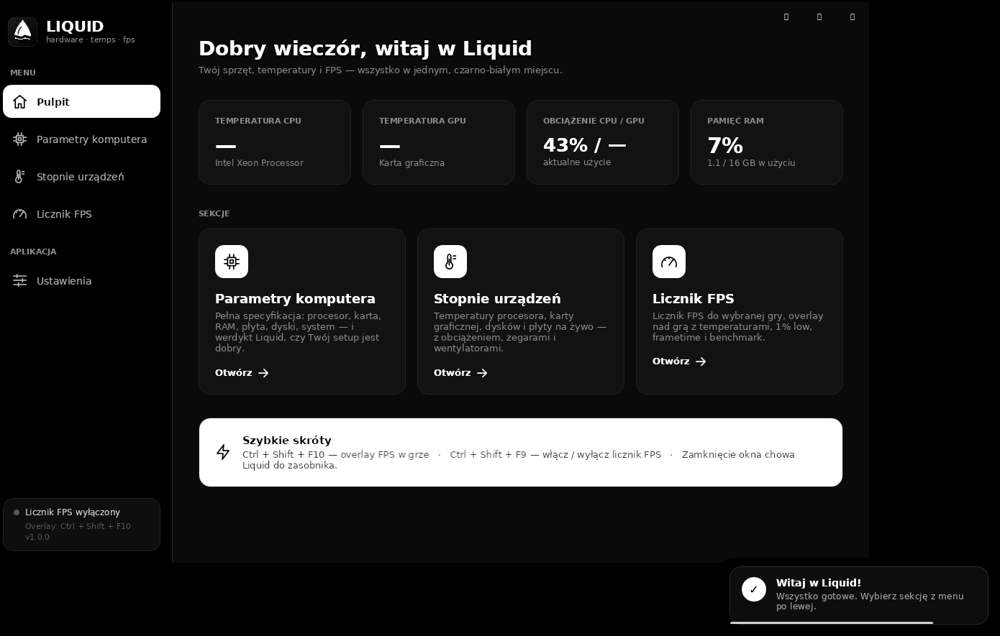
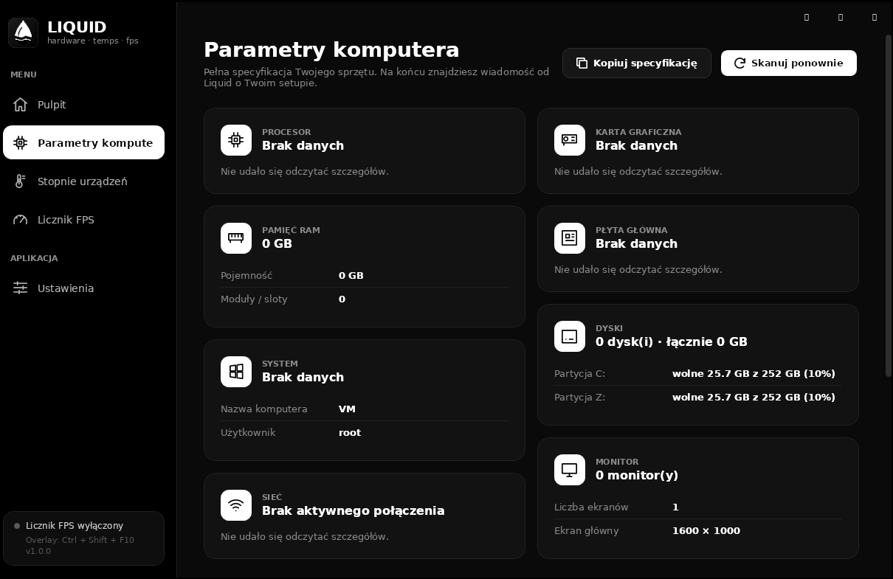
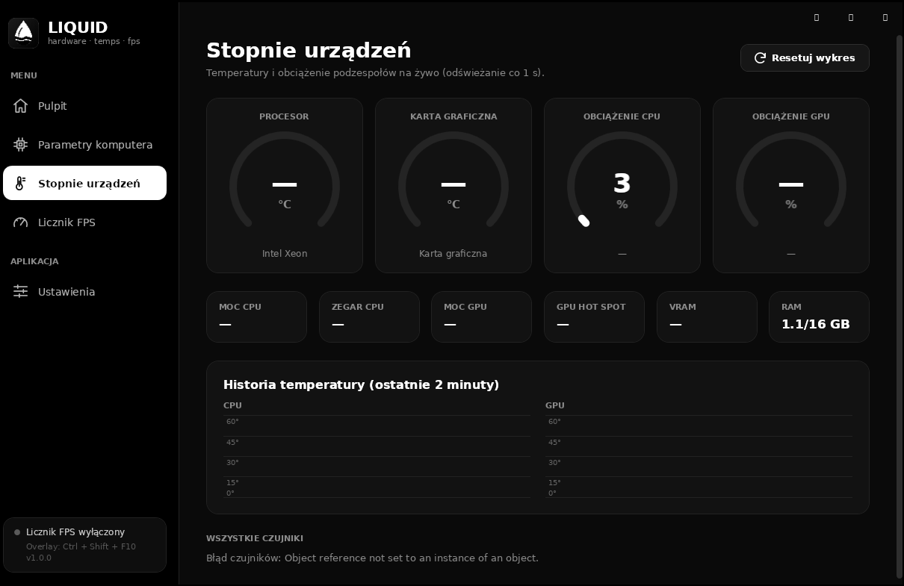
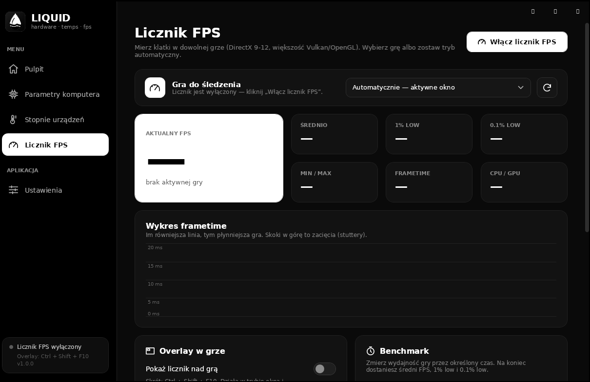
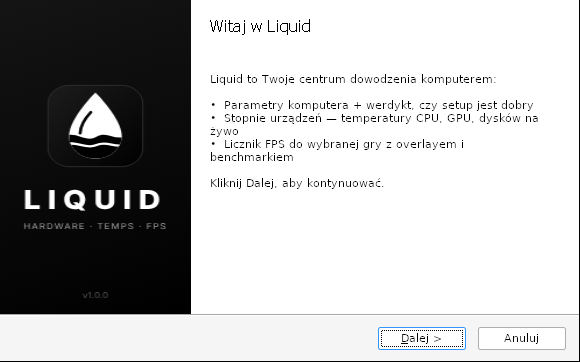

<p align="center"></p>

# Liquid

Czarno-biała aplikacja na Windows 10/11 (x64) do monitorowania komputera.



## Sekcje

| Sekcja | Co robi |
|---|---|
| **Pulpit** | Szybki podgląd: temperatury CPU/GPU, obciążenie, RAM i skróty do sekcji. |
| **Parametry komputera** | Pełna specyfikacja: procesor, karta graficzna (z prawdziwym VRAM), RAM (kości, typ, prędkość, kanały), płyta główna i BIOS, dyski (NVMe/SSD/HDD, partycje), system, monitory, sieć. Na końcu **wiadomość od Liquid** z oceną 0–100, mocnymi stronami i poradami. Przycisk „Kopiuj specyfikację”. |
| **Stopnie urządzeń** | Temperatury, obciążenie, zegary, wentylatory i pobór mocy na żywo (co 1 s), wskaźniki, historia temperatur z 2 minut, ostrzeżenia o przegrzaniu. |
| **Licznik FPS** | Licznik do wybranej gry lub tryb automatyczny (aktywne okno), FPS / średnia / 1% low / 0.1% low / min / max / frametime, wykres frametime, **overlay nad grą** (pozycja, rozmiar, krycie, CPU/GPU/RAM/zegar), **benchmark** 30 s / 60 s / 2 min. |
| **Ustawienia** | Powiadomienia, chowanie do zasobnika, autostart z Windows, progi ostrzeżeń temperatur. |

Każda akcja pokazuje ładne powiadomienie w prawym dolnym rogu (np. „Licznik FPS włączony”, „Overlay włączony”, „Wykryto grę”).

### Skróty
- **Ctrl + Shift + F10** — overlay FPS w grze (włącz/wyłącz)
- **Ctrl + Shift + F9** — licznik FPS (włącz/wyłącz)

## Instalacja
Uruchom `Liquid_Setup_1.0.0.exe` → Dalej → wybierz komponenty → Zainstaluj.
Instalator dodaje skróty (menu Start, pulpit), deinstalator w „Aplikacje i funkcje”
oraz opcjonalnie sterownik **PawnIO** (potrzebny do temperatury procesora).

Aplikacja wymaga uprawnień administratora (odczyt czujników i licznik FPS przez ETW).

## Technologia
- C# / .NET 8 / WPF, plik `.exe` self-contained (nie trzeba instalować .NET)
- Czujniki: [LibreHardwareMonitorLib](https://github.com/LibreHardwareMonitor/LibreHardwareMonitor) + PawnIO
- FPS: Event Tracing for Windows (zdarzenia Present z DXGI i D3D9 — to samo źródło co PresentMon)
- Instalator: NSIS (Modern UI 2, język polski)

## Budowanie
Wymaga .NET 8 SDK (od Microsoftu, z WindowsDesktop SDK) i NSIS (`makensis`). Działa też z Linuksa:

```bash
./build.sh   # → dist/Liquid_Setup_1.0.0.exe
```

## Ograniczenia
- Overlay działa w trybie okna i pełnoekranowym bez ramki (borderless). W „ekskluzywnym” pełnym ekranie Windows nie pozwala rysować na grze — przełącz grę na borderless.
- Gry z anty-cheatem kernelowym zwykle tolerują ETW/overlay, ale nie jest to gwarantowane.
- Exe nie jest podpisany cyfrowo, więc SmartScreen może pokazać „Nieznany wydawca” → „Więcej informacji” → „Uruchom mimo to”.

## Zrzuty ekranu
| Parametry komputera | Stopnie urządzeń |
|---|---|
|  |  |
| **Licznik FPS** | **Instalator** |
|  |  |

*(Zrzuty z testu pod Wine na Linuksie: brak danych sprzętowych i zastępcza czcionka — na Windowsie pojawią się prawdziwe wartości i Segoe UI.)*
