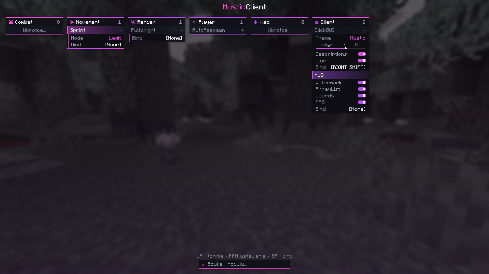

# MusticClient

Klient Fabric dla **Minecraft 1.21.4** (Java 21).

## Budowanie
```
./gradlew build
```
Gotowy plik: `build/libs/mustic-client-0.1.0.jar` → wrzuć do `.minecraft/mods` razem z Fabric API.



## ClickGUI (`Right Shift`)
- **LPM** na module – włącz/wyłącz
- **PPM** na module – rozwiń ustawienia
- **SPM** na module – ustaw bind (Delete/Backspace = brak, Esc = anuluj)
- **PPM** na nagłówku – zwiń panel, **LPM + przeciągnij** – przesuń panel
- Pisanie z klawiatury – wyszukiwarka modułów, scroll – przewijanie paneli / zmiana suwaków
- Motywy: Mustic, Rainbow, Ocean, Blood, Mint, Sunset (ClickGUI → Theme)

Config zapisuje się w `config/musticclient.json` (moduły, bindy, ustawienia, pozycje paneli).

## Struktura
- `module/` – `Module`, `Category`, `ModuleManager` (rejestracja w `ModuleManager.init()`)
- `setting/` – `BooleanSetting`, `NumberSetting`, `ModeSetting`
- `gui/` – `ClickGui`, `Panel`, `ModuleButton`, `components/`
- `module/modules/` – ClickGUI, HUD, Sprint, Fullbright, AutoRespawn

Nowy moduł = klasa dziedzicząca po `Module` + `register(new TwojModul())`.
