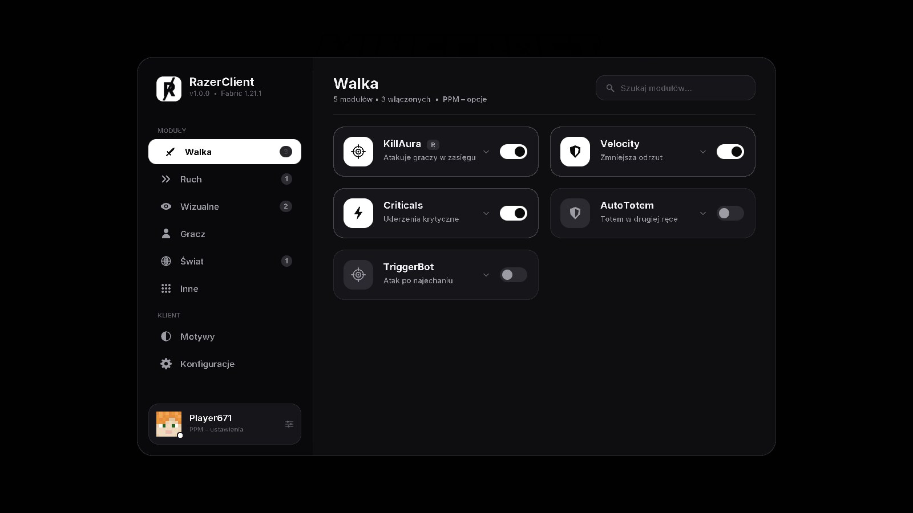
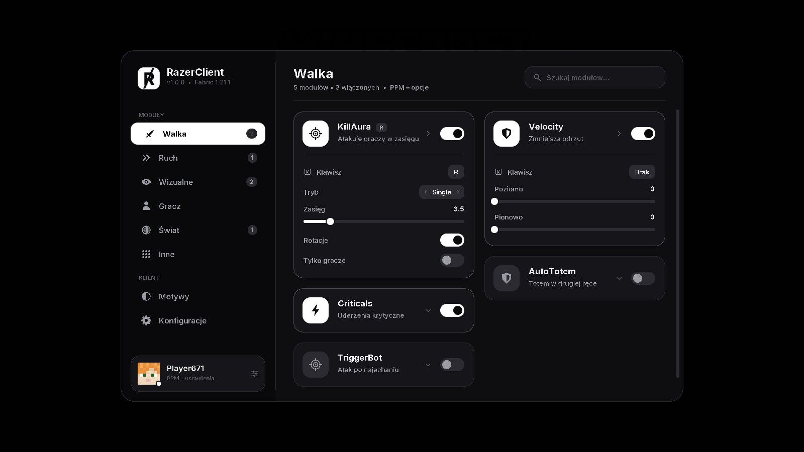
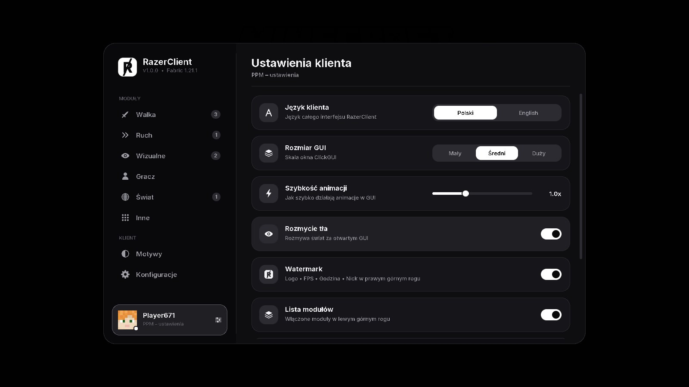
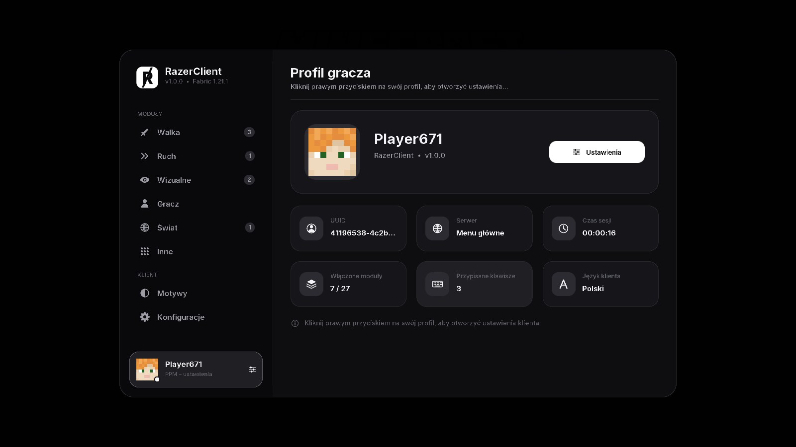

# RazerClient

Biało-czarne, nowoczesne GUI klienta do Minecraft **1.21.1 (Fabric)**: ClickGUI, HUD i powiadomienia.
To jest **sam interfejs**. Moduły to puste przełączniki bez żadnej funkcji w grze.



## Funkcje
- **ClickGUI** (`Prawy Shift`): duże okno z płynną animacją otwierania i zamykania (skala + przenikanie), gładka czcionka Inter (nie pikselowa), zaokrąglone panele z cieniem, własne ikony
- **Kategorie:** Walka, Ruch, Wizualne, Gracz, Świat, Inne, a do tego osobne strony **Motywy** i **Konfiguracje**
- Animowany wskaźnik kategorii, hover, przełączniki, suwaki i przejścia między stronami
- **LPM** na module włącza go, **PPM** rozwija opcje (klawisz, tryby, suwaki, przełączniki)
- Wyszukiwarka modułów: wystarczy zacząć pisać
- Okno można przeciągać za logo
- **Profil gracza** (głowa skina, nick, UUID, serwer, czas sesji). **PPM na profilu** otwiera ustawienia klienta: język (Polski/English), rozmiar GUI, szybkość animacji, rozmycie tła, włączanie i wyłączanie elementów HUD
- **Motywy:** Ciemny, Jasny, AMOLED, z płynnym przejściem kolorów
- **Konfiguracje:** tworzenie, zapis, wczytywanie i usuwanie (`.minecraft/razerclient/configs`)

### HUD
- **Watermark** (prawy górny róg): logo • FPS • godzina • nick
- **Lista modułów** (lewy górny róg): panel z ikonami włączonych modułów, animowany
- **KeyBinds** pod listą: moduły z przypisanym klawiszem i ich stan
- **Powiadomienia** (prawy dolny róg): ikona modułu, Włączono/Wyłączono, nazwa i klawisz, z paskiem czasu


| | |
|---|---|
|  |  |
|  |  |

## Budowanie
```
./gradlew build
```
Plik `.jar` znajdziesz w `build/libs/`. Wrzuć go do folderu `mods` razem z **Fabric API** (Fabric Loader 0.16+, MC 1.21.1).
Uruchomienie w trybie dev: `./gradlew runClient`.
