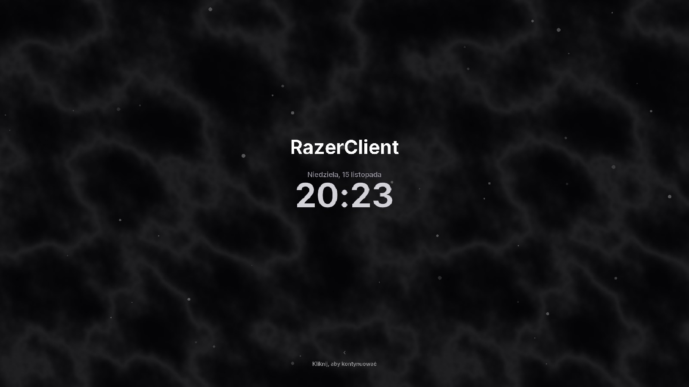
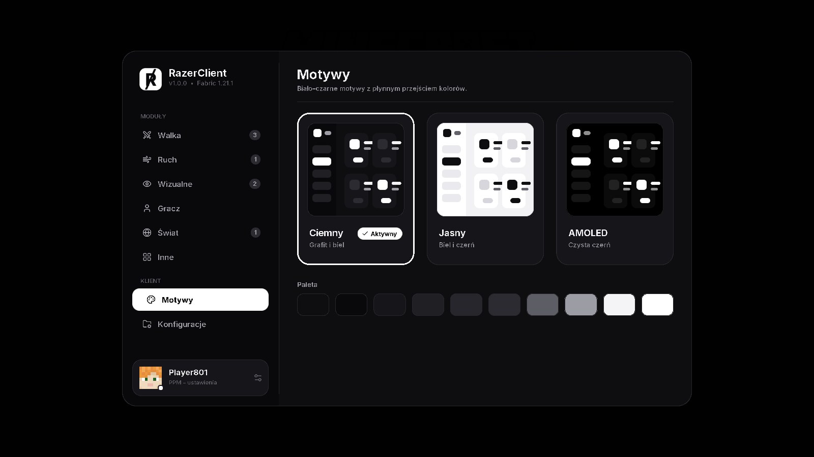
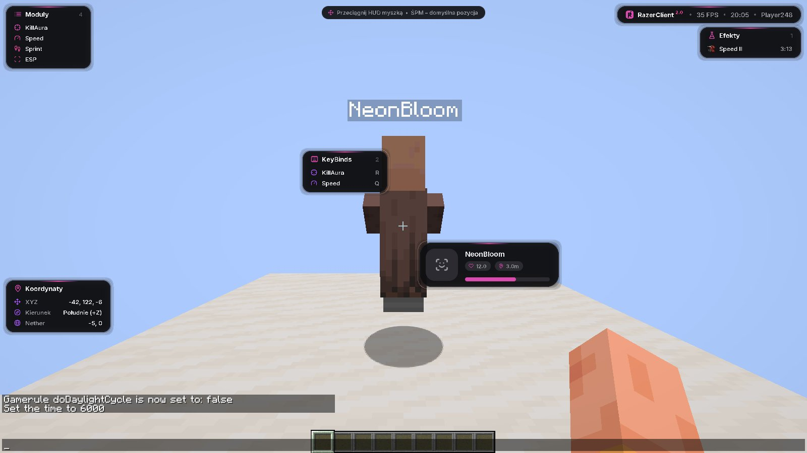
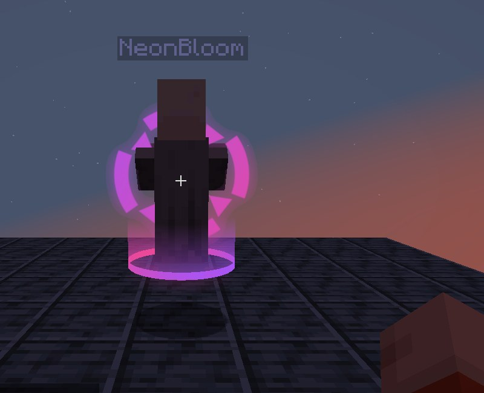
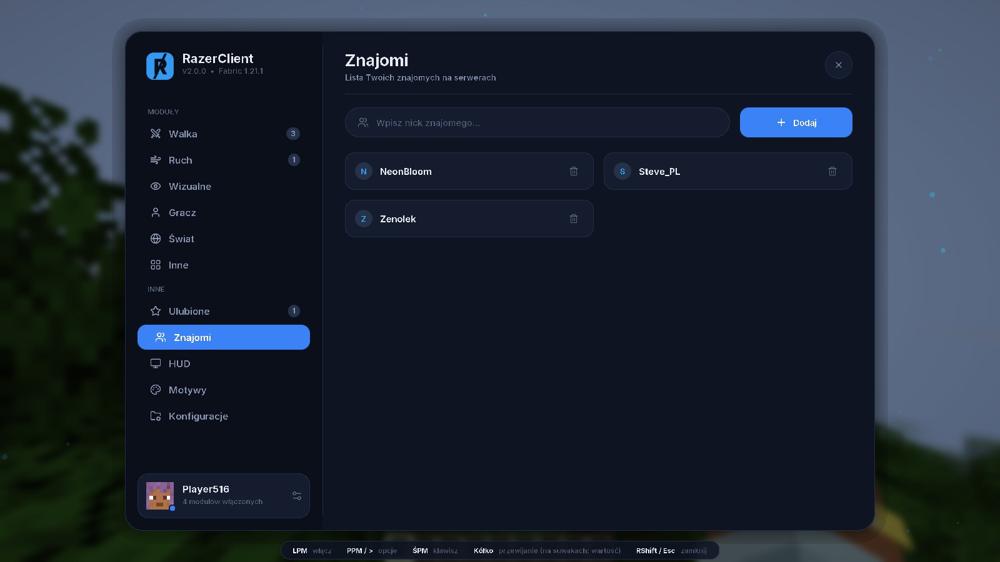

# RazerClient 2.0

Nowoczesne GUI klienta do Minecraft **1.21.1 (Fabric)**: ClickGUI, edytor HUD, motywy z kolorami akcentu i powiadomienia.
To jest **sam interfejs**. Moduły to puste przełączniki bez żadnej funkcji w grze, z wyjątkiem kosmetycznych **TargetESP**, **Ambient**, **ChinaHat**, **JumpCircles** i **Cosmetic**.

| | |
|---|---|
|  |  |



## Co nowego w 2.0
- 🎩 **ChinaHat** (Wizualne): świecący stożkowy kapelusz nad głową z gradientem w kolorze akcentu. Opcjonalnie także na znajomych. Opcje: rozmiar, wysokość, obrót
- ⭕ **JumpCircles** (Wizualne): świecące kręgi rozchodzące się pod nogami przy każdym skoku. Opcje: rozmiar, czas
- 🧥 **Cosmetic** (Inne): własna peleryna z logo RazerClient w wersjach Midnight, Czarna i Fiolet (widoczna u Ciebie)
- 🌃 **Nowe ClickGUI:** motyw **Midnight** (granatowy z niebieskim akcentem, domyślny), wartości ustawień w kolorze akcentu przy nazwie modułu (np. „KillAura Single 3.5”), pasek skrótów pod oknem, przycisk zamknięcia, pasek przewijania w kolorze akcentu, w profilu liczba włączonych modułów
- 🖱️ **ŚPM na module** przypisuje klawisz bez rozwijania opcji, **kółko na suwaku** zmienia wartość, klik w strzałkę rozwija opcje
- 👥 **Znajomi:** nowa strona, na której dodajesz i usuwasz nicki (zapisywane w konfiguracji)
- 🌌 **Własne menu główne:** ekran blokady z datą i dużą godziną na animowanym tle z falami dymu i świecącymi cząsteczkami. Po kliknięciu płynne przejście do menu z napisem RazerClient świecącym w kolorze akcentu i okrągłymi przyciskami (Jednoosobowy, Wieloosobowy, Realms, Ustawienia, Wyjdź), które unoszą się po najechaniu i pokazują podpis. Można wrócić do menu Minecrafta w ustawieniach klienta
- ✨ **Ambient** (Wizualne): świecące kulki w kolorze akcentu unoszące się w powietrzu wokół gracza. Można ustawić ilość, rozmiar i zasięg
- 🎯 **TargetESP** (Wizualne): efektowny znacznik na graczu, którego uderzyłeś albo na którego patrzysz. Pierścień z gradientem płynie w górę i w dół po sylwetce i zostawia smugę, a obracający się znacznik pulsuje i błyska na czerwono przy trafieniu. Style: **Mix**, **Duchy** (świecące komety krążące wokół gracza), **Pulse** (pulsujący świecący symbol na klatce), **Krąg** (świecący pierścień pod nogami z falą), **Pierścień**, **Znacznik**. Opcje: tylko gracze, smuga, ilość duchów, prędkość, rozmiar. Kolor bierze z akcentu. Rysowany z testem głębi, więc **nie widać go przez ściany** i jest czysto kosmetyczny
- 🎨 **Kolory akcentu z gradientem:** Mono (biało-czarny), Fiolet, Róż, Niebieski, Cyjan, Zielony, Czerwony, Złoty, z płynnym przejściem kolorów
- 🖱️ **Przesuwanie HUD przy otwartym czacie (T):** złap Watermark, KeyBinds albo dowolny inny element i przeciągnij go, gdzie chcesz. ŚPM przywraca domyślną pozycję
- 🟣 **Zaokrąglony HUD:** pigułkowy Watermark, okrągłe panele, nowy TargetHUD z zaokrągloną głową skina, pigułkami HP i dystansu, czerwonym błyskiem przy trafieniu i zaokrąglonym paskiem zdrowia
- 🖱️ **Edytor HUD:** przeciągasz każdy element myszką, z przyciąganiem do krawędzi i środka ekranu. PPM ukrywa element, ŚPM resetuje jego pozycję. Pozycje zapisują się względem rogów ekranu
- 🧩 **Nowe elementy HUD:** TargetHUD (nick, HP z animowanym paskiem, dystans, głowa skina), Zbroja (z wytrzymałością), Efekty (zastępują ikony z Minecrafta), Koordynaty (XYZ, kierunek, koordynaty Netheru/Overworldu), Informacje (ping, prędkość, serwer, czas sesji)
- ⭐ **Ulubione:** gwiazdka na module i osobna kategoria
- ✨ **Animowane tło GUI:** cząsteczki i poświata w kolorze akcentu
- 🔊 **Ciche dźwięki kliknięć** (można wyłączyć)
- 👋 **Powitanie** po wejściu na serwer
- ⌨️ **Skróty:** Ctrl+F szuka, Tab przechodzi do następnej kategorii (Shift+Tab do poprzedniej)
- 🗂️ Nowa strona **HUD** w ClickGUI z przełącznikami wszystkich elementów

## Wszystkie funkcje
- **ClickGUI** (`Prawy Shift`): płynne otwieranie i zamykanie, gładka czcionka Inter, małe ikony [Lucide](https://lucide.dev) (ISC), przeciąganie okna za logo
- Kategorie: Walka, Ruch, Wizualne, Gracz, Świat, Inne, Ulubione oraz strony HUD, Motywy i Konfiguracje
- **LPM** na module włącza go, **PPM** rozwija opcje (klawisz, tryby, suwaki, przełączniki)
- **Profil gracza**. **PPM na profilu** otwiera ustawienia klienta: język PL/EN, rozmiar GUI, szybkość animacji, rozmycie, animowane tło, dźwięki, powiadomienia, powitanie
- Motywy: Ciemny, Midnight, Jasny i AMOLED, każdy z dowolnym akcentem
- Konfiguracje (`.minecraft/razerclient/configs`), razem z ulubionymi
- HUD w stylu „embed”: Watermark, Lista modułów, Keybinds, TargetHUD, Efekty, Zbroja, Informacje, Koordynaty oraz powiadomienia o włączeniu i wyłączeniu modułu

| | |
|---|---|
|  |  |
|  |  |


|  |  |
|  |  |

## Budowanie
```
./gradlew build
```
Plik `.jar` znajdziesz w `build/libs/`. Wrzuć go do folderu `mods` razem z **Fabric API** (Fabric Loader 0.16+, MC 1.21.1).
