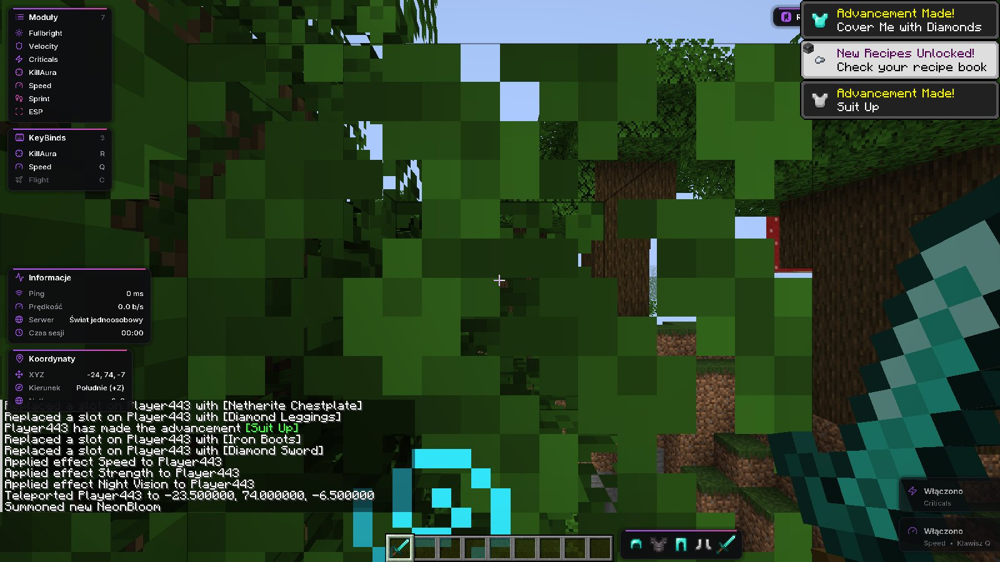
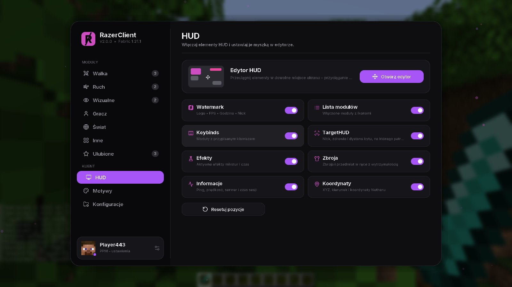
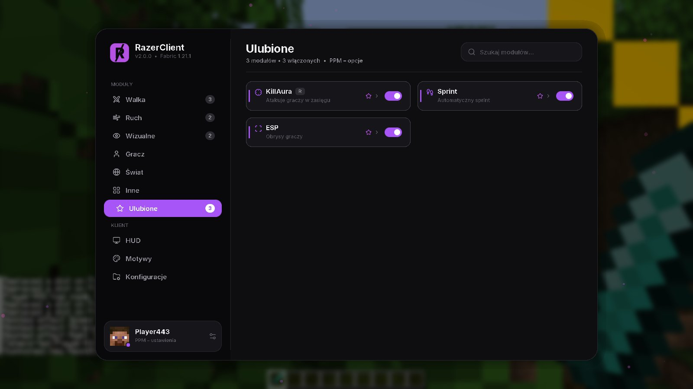
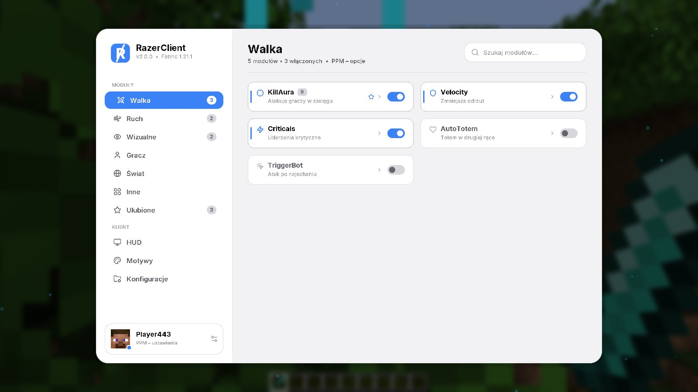

# RazerClient 2.0

Nowoczesne GUI klienta do Minecraft **1.21.1 (Fabric)**: ClickGUI, edytor HUD, motywy z kolorami akcentu i powiadomienia.
To jest **sam interfejs**. Moduły to puste przełączniki bez żadnej funkcji w grze.


## Co nowego w 2.0
- 🎨 **Kolory akcentu z gradientem:** Mono (biało-czarny), Fiolet, Róż, Niebieski, Cyjan, Zielony, Czerwony, Złoty, z płynnym przejściem kolorów
- 🖱️ **Edytor HUD:** przeciągasz każdy element myszką, z przyciąganiem do krawędzi i środka ekranu. PPM ukrywa element, ŚPM resetuje jego pozycję. Pozycje zapisują się względem rogów ekranu
- 🧩 **Nowe elementy HUD:** TargetHUD (nick, HP z animowanym paskiem, dystans, głowa skina), Zbroja (z wytrzymałością), Efekty (zastępują ikony z Minecrafta), Koordynaty (XYZ, kierunek, koordynaty Netheru/Overworldu), Informacje (ping, prędkość, serwer, czas sesji)
- ⭐ **Ulubione:** gwiazdka na module i osobna kategoria
- ✨ **Animowane tło GUI:** cząsteczki i poświata w kolorze akcentu
- 🔊 **Ciche dźwięki kliknięć** (można wyłączyć)
- 👋 **Powitanie** po wejściu na serwer
- ⌨️ **Skróty:** Ctrl+F szuka, Tab przechodzi do następnej kategorii (Shift+Tab do poprzedniej)
- 🗂️ Nowa strona **HUD** w ClickGUI z przełącznikami wszystkich elementów

## Wszystkie funkcje
- **ClickGUI** (`Prawy Shift`): płynne otwieranie i zamykanie, gładka czcionka Inter, małe ikony [Lucide](https://lucide.dev) (ISC), przeciąganie okna za logo
- Kategorie: Walka, Ruch, Wizualne, Gracz, Świat, Inne, Ulubione oraz strony HUD, Motywy i Konfiguracje
- **LPM** na module włącza go, **PPM** rozwija opcje (klawisz, tryby, suwaki, przełączniki)
- **Profil gracza**. **PPM na profilu** otwiera ustawienia klienta: język PL/EN, rozmiar GUI, szybkość animacji, rozmycie, animowane tło, dźwięki, powiadomienia, powitanie
- Motywy: Ciemny, Jasny i AMOLED, każdy z dowolnym akcentem
- Konfiguracje (`.minecraft/razerclient/configs`), razem z ulubionymi
- HUD w stylu „embed”: Watermark, Lista modułów, Keybinds, TargetHUD, Efekty, Zbroja, Informacje, Koordynaty oraz powiadomienia o włączeniu i wyłączeniu modułu

| | |
|---|---|
|  |  |
|  |  |
|  |  |

## Budowanie
```
./gradlew build
```
Plik `.jar` znajdziesz w `build/libs/`. Wrzuć go do folderu `mods` razem z **Fabric API** (Fabric Loader 0.16+, MC 1.21.1).
