# RazerClient 3.5

Nowoczesne GUI klienta do Minecraft **1.21.1 (Fabric)**: ClickGUI, edytor HUD, motywy z kolorami akcentu i powiadomienia.
To jest **sam interfejs**. Moduły to puste przełączniki bez żadnej funkcji w grze, z wyjątkiem kosmetycznych **TargetESP**, **Ambient**, **ChinaHat**, **JumpCircles**, **Cosmetic**, **HitSound**, **Nametags**, **Sky** i **ToolColor**.

| | |
|---|---|
|  | 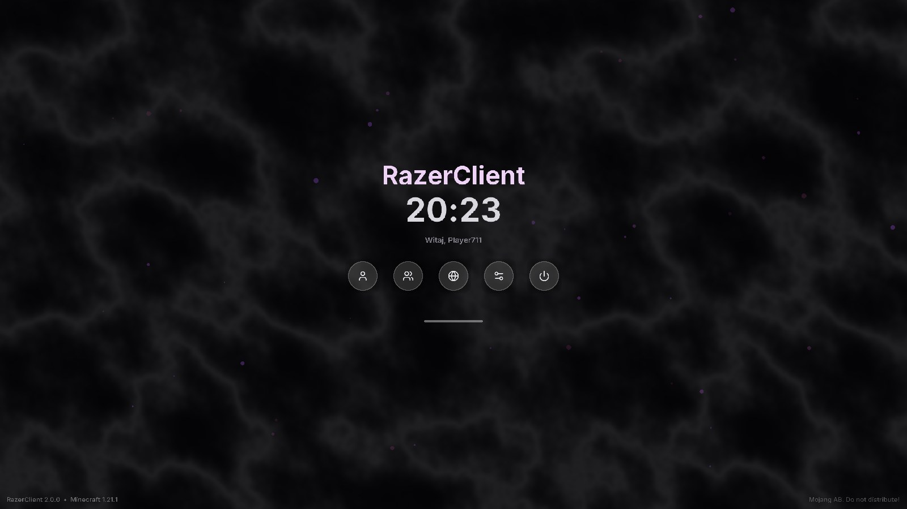 |

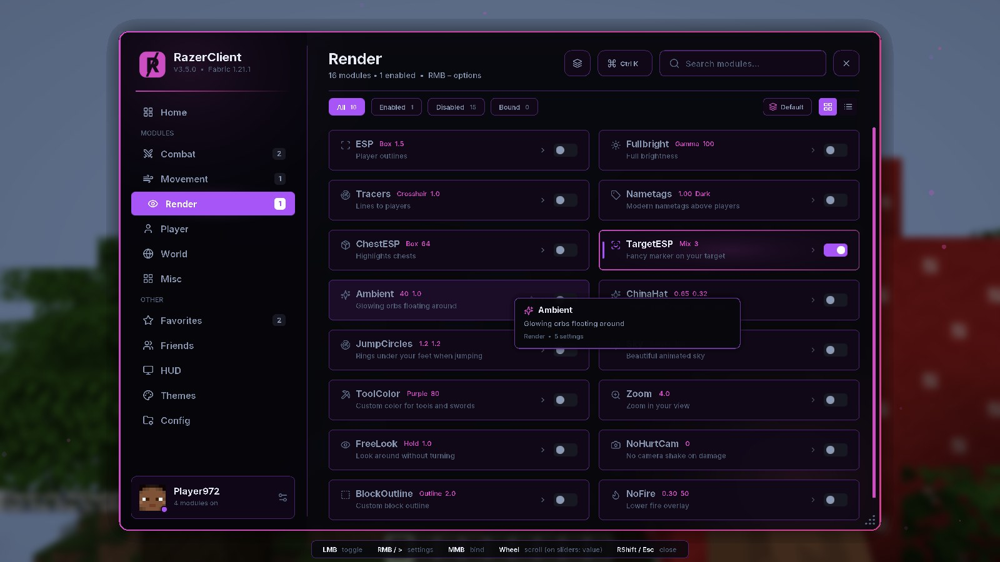

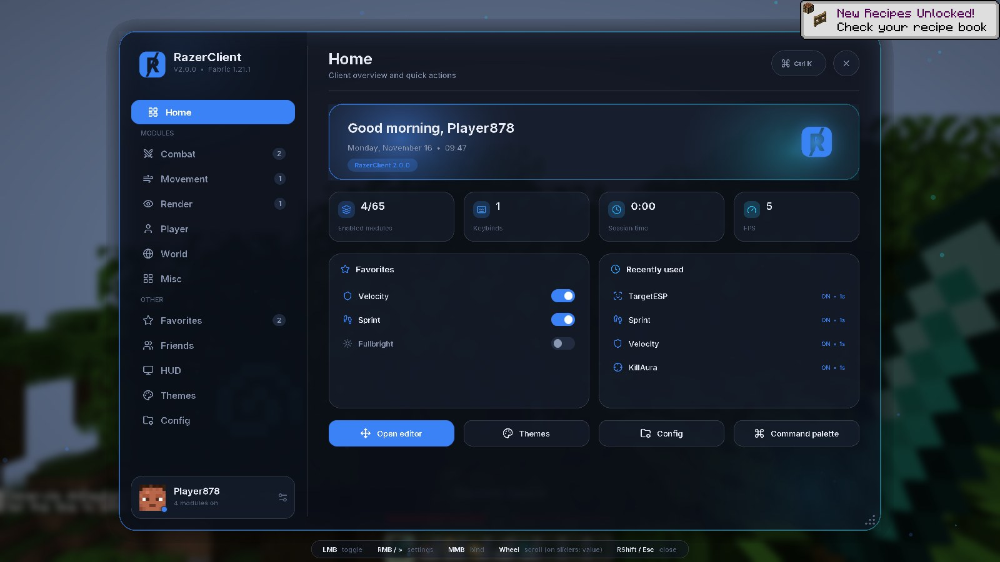

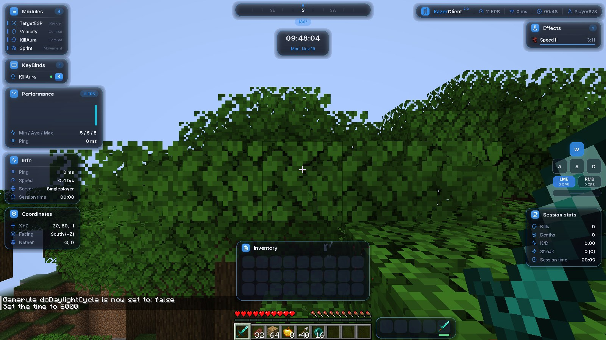

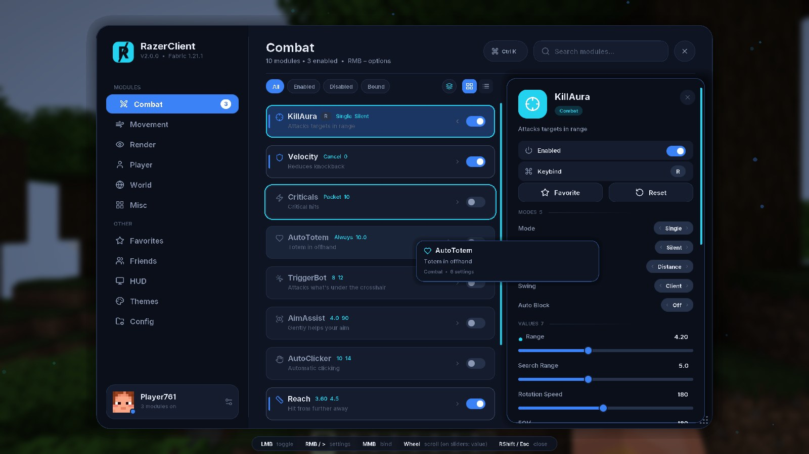

| | |
|---|---|
| 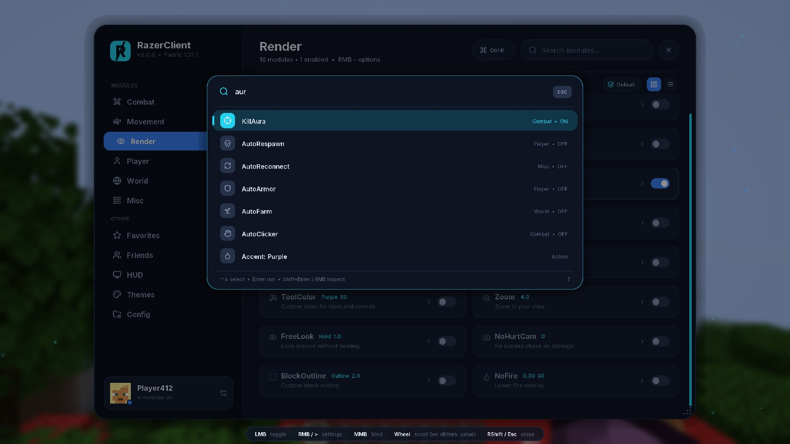 | 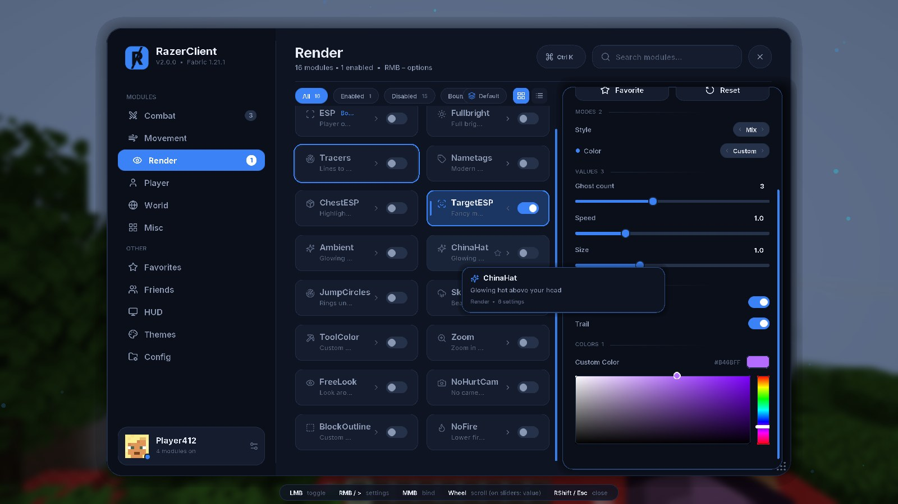 |

## Co nowego w 3.5
- 🌌 **Styl Neon** (nowy domyślny wygląd ClickGUI): ten sam układ okna, ale prawie czarne tło, świecące obramowania z gradientem w kolorze akcentu, ostrzejsze rogi, poświaty przy zaznaczonej kategorii i włączonych modułach. Przełącznik **Solid / Glass / Neon** jest na stronie Motywy
- 🎨 **Style HUD:** Glass, Neon (ciemne tło i świecący obrys) oraz Minimal (prawie bez tła). Przełącznik na stronie HUD
- 🧩 Opcjonalny układ **Panels** (pływające panele kategorii) w ustawieniach klienta; domyślnie zostaje okno

## Co nowego w 2.0
- 🪟 **Styl Glass:** półprzezroczyste panele z gradientowym obramowaniem, połyskiem i poświatami w kolorach akcentu, w ClickGUI, HUD, powiadomieniach, Inspektorze i palecie. Przełącznik **Solid / Glass** jest na stronie Motywy
- 🏠 **Strona Home:** powitanie z datą, kafelki statystyk (moduły, klawisze, czas sesji, FPS), szybkie przełączniki ulubionych, ostatnio używane moduły i szybkie akcje
- 🧩 **Nowe elementy HUD:** **Keystrokes** (WASD, spacja, LMB/RMB z licznikiem CPS), **Kompas** (pasek kierunków ze stopniami), **Zegar** (z sekundami i datą), **Ekwipunek** (podgląd 3 rzędów), **Statystyki sesji** (zabójstwa, śmierci, K/D, seria) i **Wydajność** (wykres FPS z 30 s, min/średnia/max, ping)
- 🗂️ **Presety układu HUD:** Klasyczny, Minimalny, PvP, Wszystko (strona HUD)
- 🧠 **Zaawansowane ClickGUI:**
  - **Inspektor modułu** (PPM na module): panel wysuwany z prawej z opisem, przełącznikiem, klawiszem, ulubionymi, resetem i ustawieniami w sekcjach Modes / Values / Toggles / Colors. Zmienione ustawienia mają kropkę, która po kliknięciu przywraca wartość domyślną. Kliknięcie wartości liczbowej pozwala wpisać dokładną liczbę
  - **Paleta komend (Ctrl+K):** wyszukiwanie fuzzy modułów, stron i akcji (motyw, akcent, język, edytor HUD, zapis konfiguracji, wyłącz wszystko). Enter uruchamia, Shift+Enter otwiera inspektor
  - **Filtry** (Wszystkie / Włączone / Wyłączone / Z klawiszem), **sortowanie** (Domyślnie / A–Z / Włączone) i **widok siatki albo listy**
  - **Picker kolorów** (pole nasycenia i jasności z paskiem odcienia) dla TargetESP, Ambient, ChinaHat i JumpCircles (opcja Color: Accent / Custom)
  - **Podpowiedzi** po najechaniu na moduł, **animacja wejścia kart** i **fala przy kliknięciu**
  - **Nawigacja klawiaturą:** strzałki, Enter włącza, Spacja otwiera inspektor, Esc zamyka inspektor
  - **Zmiana rozmiaru okna** przeciąganiem prawego dolnego rogu (zapamiętywana)
- 🗡️ **ToolColor** (Render): własny kolor mieczy, siekier, kilofów, łopat, motyk, trójzębu, buzdyganu i łuków, w ręce i w ekwipunku. Tekstura jest zamieniana na odcienie szarości i kolorowana, więc kolor jest czysty. Do wyboru: Purple, White, Black, Blue, Red, Green, Gold, Pink, Cyan, Accent i Rainbow. Opcje: intensywność, połysk, miecze, narzędzia, inna broń
- 🌌 **Sky** (Render): własne animowane niebo z presetami **Aurora**, **Galaxy**, **Sunset**, **Midnight** i **Accent**. Gradient nieba, migoczące kolorowe gwiazdy, falująca zorza polarna, mgławice, Droga Mleczna (Galaxy), spadające gwiazdy i kolor mgły dopasowany do nieba. Opcje: gwiazdy, ich ilość, zorza, mgławice, spadające gwiazdy, kolor mgły, prędkość, jasność
- 🏷️ **Nametags** (Render): nowoczesne, zaokrąglone nicki zamiast tych z Minecrafta. Głowa skina z drugą warstwą, nick, pigułka z HP w kolorze od zielonego do czerwonego, pancerz, ping, dystans i pasek zdrowia w kolorze akcentu. Znajomi są wyróżnieni akcentem i ikonką. Tło Dark, Glass albo None, opcja „Self” pokazuje własny nick w F5. Rysowane z testem głębi, więc nie widać ich przez ściany
- 🌍 **Klient domyślnie po angielsku** (polski do wyboru w ustawieniach klienta)
- 🧩 **5 nowych modułów w każdej kategorii** (łącznie 59): AimAssist, AutoClicker, Reach, WTap, HitBoxes · Spider, LongJump, Jesus, ElytraBoost, AirJump · Zoom, FreeLook, NoHurtCam, BlockOutline, NoFire · AutoEat, AutoTool, ChestStealer, FastUse, AutoRespawn · AutoFarm, Weather, LiquidPlace, AutoSign, TimeChanger · NameProtect, AutoGG, ChatSuffix, AntiBot, FakePlayer
- ⚙️ **Dużo ustawień w każdym module**, np. KillAura: Mode, Rotations (Silent/Legit/Snap/None), Priority, Range, Search Range, Rotation Speed, FOV, Min/Max CPS, Switch Delay, Rage Mode, Through Walls, Raytrace, Keep Sprint, Swing, Auto Block, wybór celów i inne
- 🔔 **Powiadomienia jako element HUD:** można je wyłączyć na stronie HUD i przesunąć w edytorze albo przy czacie. Stos rośnie w górę lub w dół zależnie od miejsca
- 💎 **Nowy HUD:** panele z gradientowym tłem, połyskiem i poświatą w kolorze akcentu; nagłówki z ikoną w świecącej plakietce i licznikiem w pigułce. Watermark ma sekcje z ikonami (FPS, ping, godzina, nick). KeyBinds pokazuje klawisze jak na klawiaturze i zieloną kropkę stanu, lista modułów ma kolorowe paski i kategorie. Zbroja ma kolorowe paski wytrzymałości, efekty paski pozostałego czasu, a powiadomienia ikonę w świecącym kółku i znaczek ON/OFF
- 🔊 **HitSound** (Inne): dźwięk przy każdym uderzeniu. Do wyboru 13 dźwięków: 7 własnych, zsyntetyzowanych do RazerClient (Razer, Pop, Glass, Coin, Laser, Bubble, Thump) i 6 z Minecrafta (Dzwonek, Pling, Kurant, XP, Ametyst, Krytyk). Zmiana dźwięku w opcjach od razu go odtwarza. Opcje: głośność, wysokość, losowa wysokość, tylko gracze
- 🎩 **ChinaHat** (Wizualne): świecący stożkowy kapelusz nad głową z gradientem w kolorze akcentu. Opcjonalnie także na znajomych. Opcje: rozmiar, wysokość, obrót
- ⭕ **JumpCircles** (Wizualne): świecące kręgi rozchodzące się pod nogami przy każdym skoku. Opcje: rozmiar, czas
- 🧥 **Cosmetic** (Inne): własna peleryna z logo RazerClient w wersjach Midnight, Czarna i Fiolet (widoczna u Ciebie)
- 🌃 **Nowe ClickGUI:** motyw **Midnight** (granatowy z niebieskim akcentem, domyślny), wartości ustawień w kolorze akcentu przy nazwie modułu (np. „KillAura Single 3.5”), pasek skrótów pod oknem, przycisk zamknięcia, pasek przewijania w kolorze akcentu, w profilu liczba włączonych modułów
- 🖱️ **ŚPM na module** przypisuje klawisz bez rozwijania opcji, **kółko na suwaku** zmienia wartość, klik w strzałkę rozwija opcje
- 👥 **Znajomi:** nowa strona, na której dodajesz i usuwasz nicki (zapisywane w konfiguracji)
- 🌌 **Własne menu główne:** ekran blokady z datą i dużą godziną na animowanym tle z falami dymu i świecącymi cząsteczkami. Po kliknięciu płynne przejście do menu z napisem RazerClient świecącym w kolorze akcentu i okrągłymi przyciskami (Jednoosobowy, Wieloosobowy, Realms, Ustawienia, Wyjdź), które unoszą się po najechaniu i pokazują podpis. Można wrócić do menu Minecrafta w ustawieniach klienta
- ✨ **Ambient** (Wizualne): świecące kulki w kolorze akcentu unoszące się w powietrzu wokół gracza. Można ustawić ilość, rozmiar i zasięg
- 🎯 **TargetESP** (Wizualne): efektowny znacznik na graczu, którego uderzyłeś albo na którego patrzysz. Pierścień z gradientem płynie w górę i w dół po sylwetce i zostawia smugę, a obracający się znacznik pulsuje i błyska na czerwono przy trafieniu. Style (13): **Mix**, **Ghosts** (świecące komety krążące wokół gracza), **Pulse** (pulsujący symbol na klatce), **Circle** (krąg pod nogami z falą), **Ring**, **Marker**, **Orbit** (pierścienie jak atom), **Helix** (podwójna spirala DNA), **Halo** (aureola nad głową), **Sparkles** (iskierki), **Brackets** (narożniki celownika i pasek HP), **Vortex** (wir kropek) i **Crystal** (obracający się kryształ nad głową). Opcje: tylko gracze, smuga, ilość duchów, prędkość, rozmiar.
- 🎨 **Kolory akcentu z gradientem:** Mono (biało-czarny), Fiolet, Róż, Niebieski, Cyjan, Zielony, Czerwony, Złoty, z płynnym przejściem kolorów
- 🖱️ **Przesuwanie HUD przy otwartym czacie (T):** złap Watermark, KeyBinds albo dowolny inny element i przeciągnij go, gdzie chcesz. ŚPM przywraca domyślną pozycję
- 🟣 **Zaokrąglony HUD:** pigułkowy Watermark, okrągłe panele, nowy TargetHUD z zaokrągloną głową skina, pigułkami HP i dystansu, czerwonym błyskiem przy trafieniu i zaokrąglonym paskiem zdrowia
- 🖱️ **Edytor HUD:** przeciągasz każdy element myszką, z przyciąganiem do krawędzi i środka ekranu. PPM ukrywa element, ŚPM resetuje jego pozycję. Pozycje zapisują się względem rogów ekranu
- 🧩 **Nowe elementy HUD:** TargetHUD (nick, HP z animowanym paskiem, dystans, głowa skina), Zbroja (z wytrzymałością), Efekty (zastępują ikony z Minecrafta), Koordynaty (XYZ, kierunek, koordynaty Netheru/Overworldu), Informacje (ping, prędkość, serwer, czas sesji)
- ⭐ **Ulubione:** gwiazdka na module i osobna kategoria
- ✨ **Animowane tło GUI:** cząsteczki i poświata w kolorze akcentu
- 🔊 **Ciche dźwięki kliknięć** (można wyłączyć)
- 👋 **Powitanie** po wejściu na serwer
- ⌨️ **Skróty:** Ctrl+F szuka, Tab przechodzi do następnej kategorii (Shift+Tab do poprzedniej)
- 🗂️ Nowa strona **HUD** w ClickGUI z przełącznikami wszystkich elementów

## Wszystkie funkcje
- **ClickGUI** (`Prawy Shift`): płynne otwieranie i zamykanie, gładka czcionka Inter, małe ikony [Lucide](https://lucide.dev) (ISC), przeciąganie okna za logo
- Kategorie: Walka, Ruch, Wizualne, Gracz, Świat, Inne, Ulubione oraz strony HUD, Motywy i Konfiguracje
- **LPM** na module włącza go, **PPM** rozwija opcje (klawisz, tryby, suwaki, przełączniki)
- **Profil gracza**. **PPM na profilu** otwiera ustawienia klienta: język PL/EN, rozmiar GUI, szybkość animacji, rozmycie, animowane tło, dźwięki, powiadomienia, powitanie
- Motywy: Ciemny, Midnight, Jasny i AMOLED, każdy z dowolnym akcentem
- Konfiguracje (`.minecraft/razerclient/configs`), razem z ulubionymi
- HUD w stylu „embed”: Watermark, Lista modułów, Keybinds, TargetHUD, Efekty, Zbroja, Informacje, Koordynaty oraz powiadomienia o włączeniu i wyłączeniu modułu

| | |
|---|---|
|  | 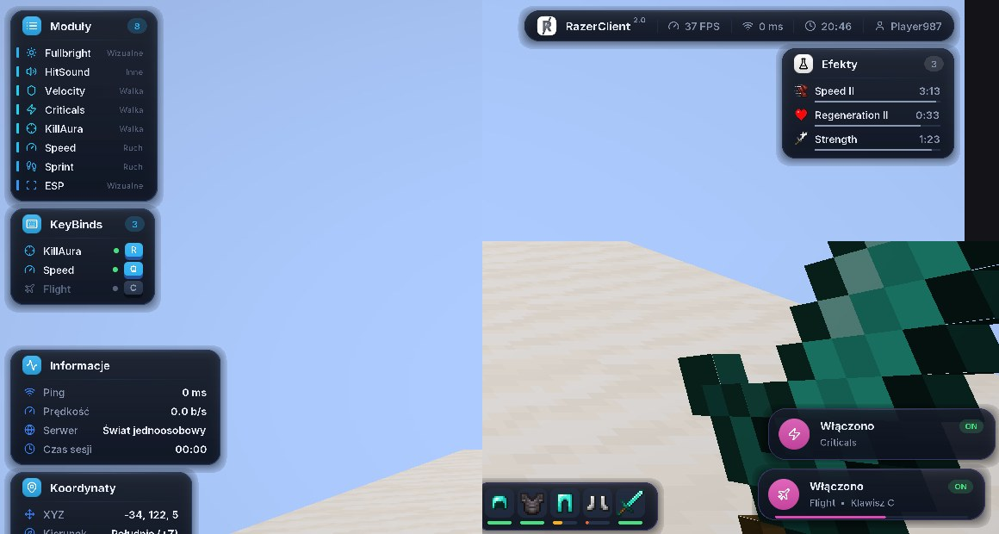 |
| 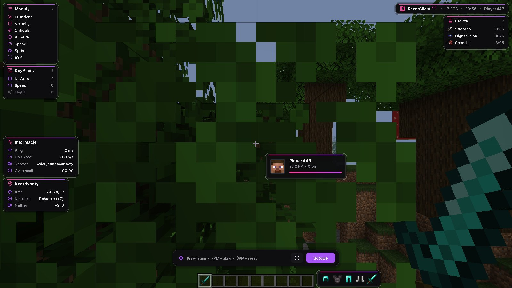 | |
|  |  |

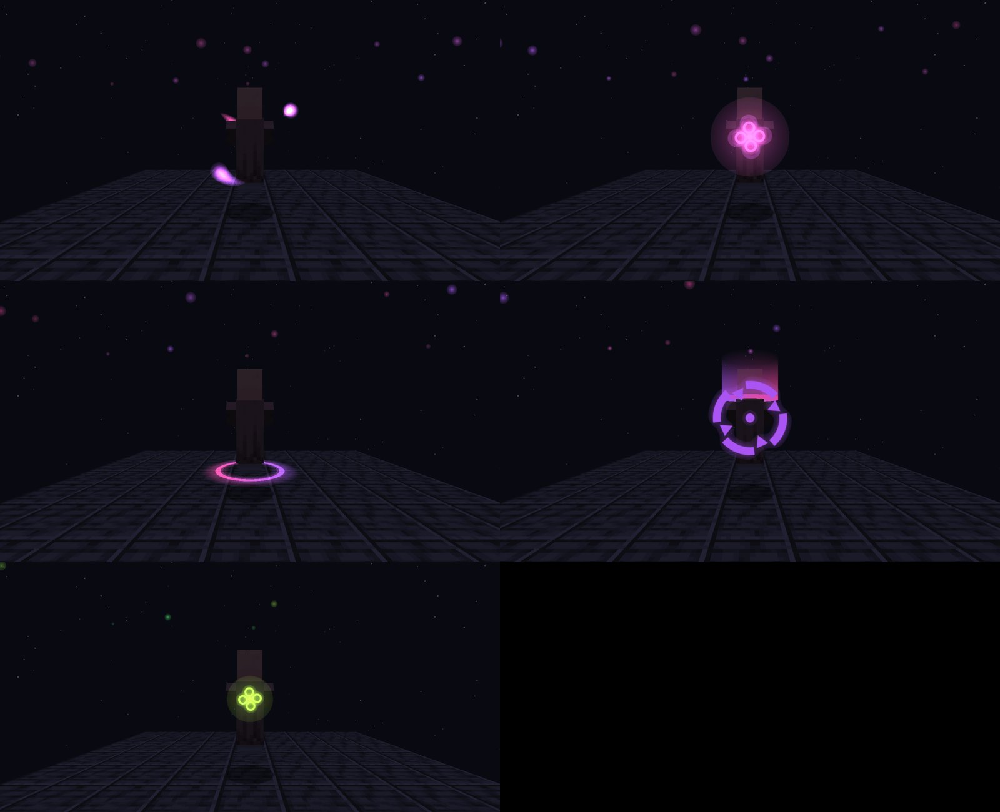

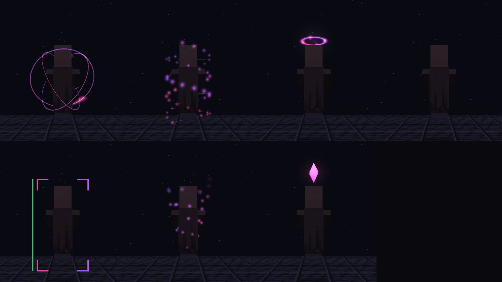

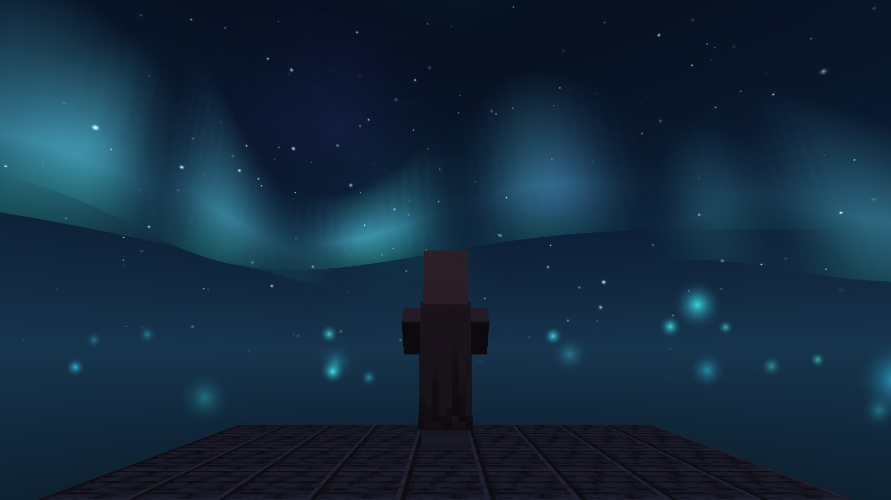

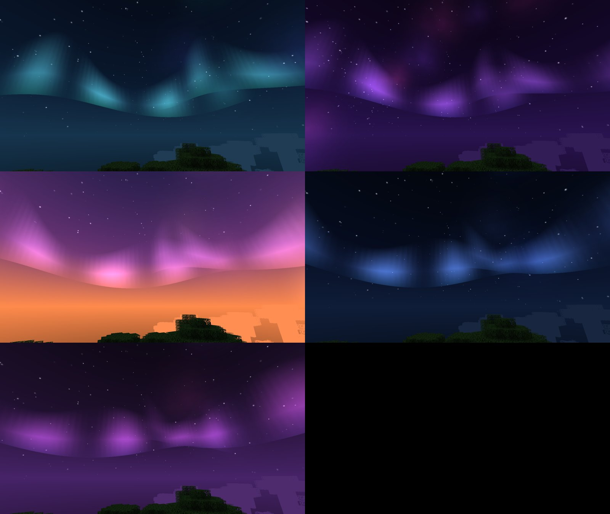

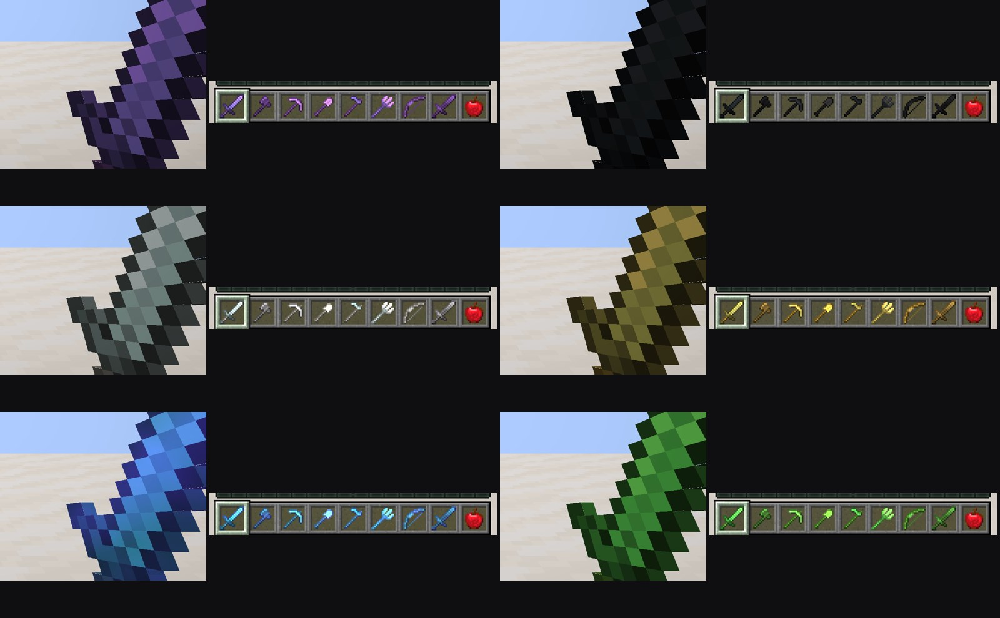

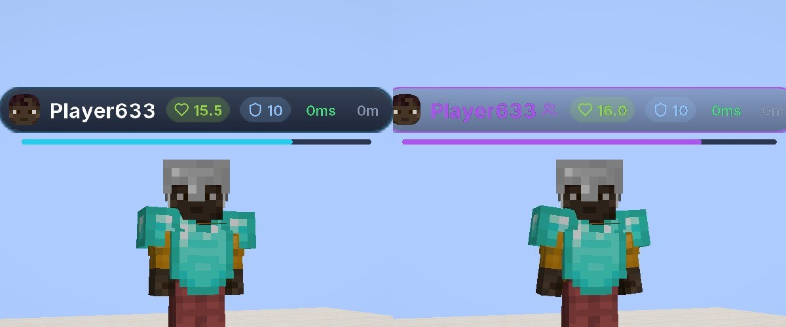

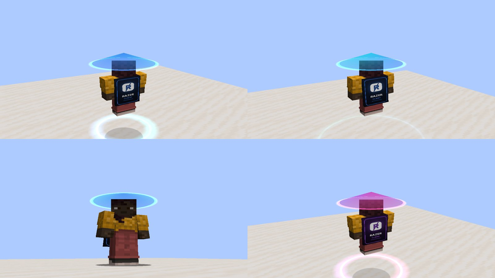

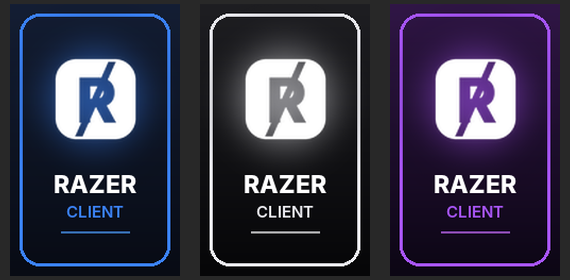
|  | 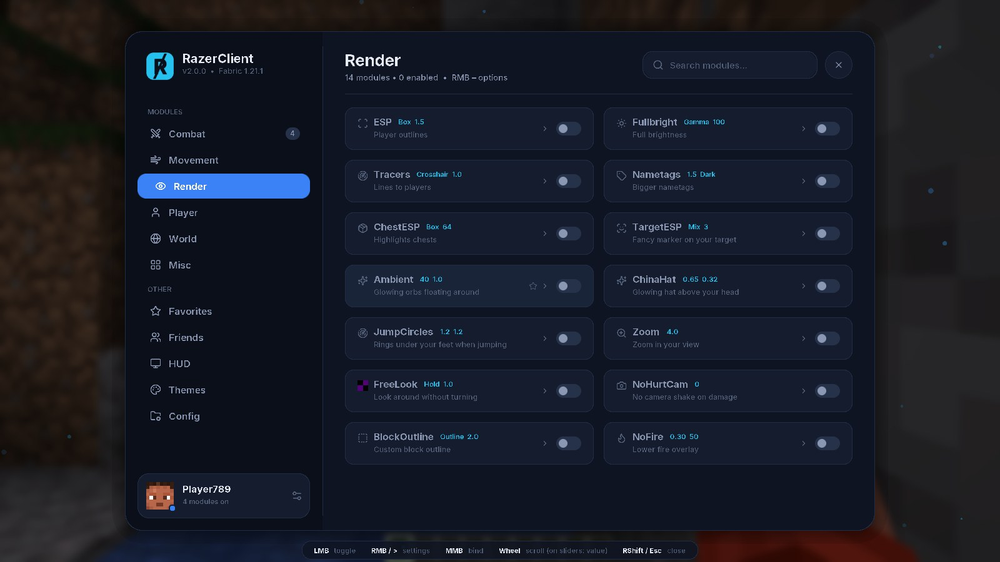 |
|  |  |

## Budowanie
```
./gradlew build
```
Plik `.jar` znajdziesz w `build/libs/`. Wrzuć go do folderu `mods` razem z **Fabric API** (Fabric Loader 0.16+, MC 1.21.1).
