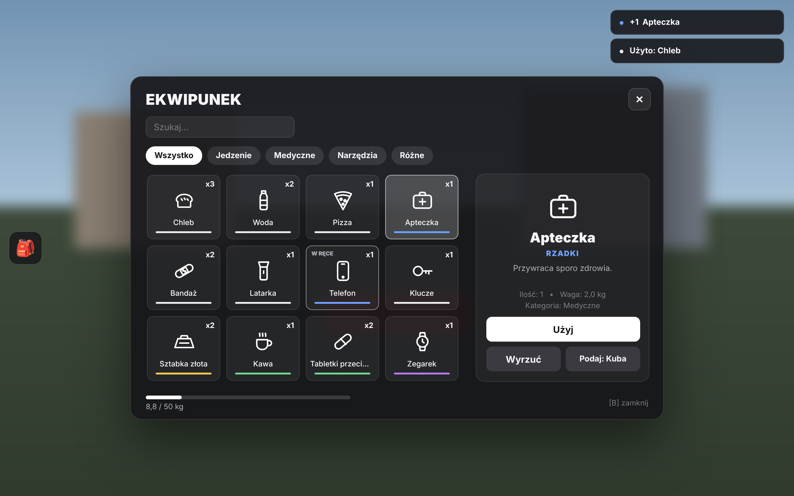

# 🎒 Ekwipunek RP do Roblox Studio — pełna instrukcja

Ekwipunek w stylu RP: ciemne, szklane okno z białymi ikonami, zakładki kategorii, wyszukiwarka, karty z ilością i paskiem rzadkości, panel szczegółów (Użyj / Wyrzuć / Podaj) oraz waga (np. `19,0 / 50 kg`). Otwierasz go klawiszem **B**.



---

## ✦ Funkcje

| | |
|---|---|
| 🗂️ Zakładki | Wszystko, Jedzenie, Medyczne, Narzędzia, Różne (możesz dodać własne) |
| 🔍 Szukaj | Filtrowanie po nazwie |
| ⚖️ Waga | Każdy przedmiot coś waży, a limit to 50 kg. Za ciężkiego przedmiotu nie podniesiesz |
| ✨ Użyj | Jedzenie i leki leczą (kawa daje boost szybkości), narzędzia biorą się do ręki |
| ⬇️ Wyrzuć | Przedmiot ląduje na ziemi z podpisem i każdy może go podnieść (**E**) |
| 🤝 Podaj | Przekazanie przedmiotu najbliższemu graczowi (do 8 studów) |
| 🔦 Narzędzia | Latarka świeci (klik = włącz/wyłącz), kij bejsbolowy bije, telefon jest w ręce |
| 💾 Zapis | Zapis po wyjściu, co 2 minuty i przy wyłączeniu serwera |
| 🛡️ Bezpieczny | Wszystko liczy serwer, więc exploiter nie doda sobie przedmiotów |
| 📱 Telefon | Przycisk 🎒 na ekranie, UI skaluje się do ekranu |
| 🌫️ Rozmycie | Po otwarciu EQ tło się rozmywa |

**Sterowanie:** `B` otwórz/zamknij • klik = zaznacz • 2× klik = użyj • `E` podnieś z ziemi.

---

## ✦ Instalacja — sposób 1 (najszybszy)

W folderze `modele/` są 3 pliki. W Roblox Studio włącz **View → Explorer** i przeciągnij:

| Plik | Upuść na |
|---|---|
| `EQShared.rbxmx` | **ReplicatedStorage** |
| `EQSystem.rbxmx` | **ServerScriptService** |
| `EQClient.rbxmx` | **StarterPlayer → StarterPlayerScripts** |

Możesz też kliknąć PPM na usłudze → **Insert from File...** i wybrać plik.

## ✦ Instalacja — sposób 2 (kopiuj-wklej)

Kod jest w folderze `src/`. Utwórz taką strukturę (PPM → *Insert Object*) i wklej kod do każdego skryptu:

```
ReplicatedStorage
└── 📁 EQShared                (Folder)
    ├── 📜 EQConfig            (ModuleScript)  ← src/EQConfig.lua
    └── 📜 ItemData            (ModuleScript)  ← src/ItemData.lua
ServerScriptService
└── 📁 EQSystem                (Folder)
    ├── 📜 EQService           (ModuleScript)  ← src/EQService.lua
    └── 📜 EQServer            (Script)        ← src/EQServer.server.lua
StarterPlayer
└── StarterPlayerScripts
    └── 📜 EQClient            (LocalScript)   ← src/EQClient.client.lua
ServerStorage
└── 📁 EQTools                 (Folder, opcjonalnie: własne modele narzędzi)
```

⚠️ Nazwy i typy (ModuleScript / Script / LocalScript) muszą się zgadzać **co do litery**.

## ✦ Włącz zapis

1. *File → Publish to Roblox*.
2. *Home → Game Settings → Security* → włącz **Enable Studio Access to API Services** → *Save*.

---

## ✦ Białe ikony (żeby wyglądało jak na podglądzie)

Bez tego kroku system działa, ale zamiast białych ikon będą kolorowe emoji.

1. W Studio: **View → Asset Manager** → zakładka **Images** → przycisk **Bulk Import** (ikona chmurki ze strzałką).
2. Zaznacz wszystkie pliki z folderu `ikony/` (14 plików PNG) i wgraj je.
3. Po wgraniu kliknij PPM na obrazku → **Copy Asset ID**.
4. W **ItemData** wklej ID do pola `Icon` danego przedmiotu, np.:
   ```lua
   Apteczka = { ..., Icon = "rbxassetid://1234567890" },
   ```
   Nazwa pliku = ID przedmiotu (`Apteczka.png` → `Apteczka`).

Roblox sprawdza każdy obrazek przez moderację, więc ikona może pojawić się po kilku minutach.

---

## ✦ Test

1. Kliknij **Play**. W Output pojawi się `[EQ] Ekwipunek RP uruchomiony (max 50 kg)`.
2. Wciśnij **B**. Na start masz telefon, chleb i wodę.
3. Wokół spawnu leży 10 przedmiotów testowych (apteczka, latarka, złoto...). Podejdź i wciśnij **E**.
4. Komendy na czacie (działają w Studio i dla twórcy gry): `!daj Apteczka 2`, `!lista`, `!wyczysc`.
5. Żeby przetestować **Podaj**, użyj *Test → Clients and Servers → 2 Players*.

Przed premierą ustaw w `EQConfig` wartość `Config.DemoPickups = false`.

---

## ✦ Dodawanie przedmiotów

W **ItemData** skopiuj istniejący wpis i zmień go:

```lua
Kanapka = {
	Name = "Kanapka", Description = "Z szynką i serem.",
	Category = "Jedzenie",      -- Jedzenie / Medyczne / Narzedzia / Rozne
	Rarity = "Common",          -- Common / Uncommon / Rare / Epic / Legendary
	Type = "Consumable",        -- Consumable (do użycia) / Tool (do ręki) / Item (zwykły)
	Weight = 0.3, MaxStack = 10,
	Heal = 15,
	Emoji = "🥪", Icon = "",
},
```

* **Consumable:** `Heal`, `SpeedBoost`, `JumpBoost`, `Duration`
* **Tool:** `Damage`, `Cooldown`, `Range` (broń), `Light = true` (latarka), `ToolName`
* **Nowa zakładka:** dopisz `{ Id = "Bron", Name = "Broń" }` w `Config.Categories` i ustaw przedmiotom `Category = "Bron"`.

### Własne modele narzędzi
Wrzuć Tool do **ServerStorage → EQTools** i nazwij go tak jak ID przedmiotu (np. `Telefon`). System da graczowi Twój model razem z jego skryptami. Bez tego system zrobi prosty model sam.

### Przedmioty do podniesienia na mapie
Zaznacz Part albo Model → **Properties → Attributes → +**:

| Atrybut | Typ | Przykład | Opis |
|---|---|---|---|
| `EQItem` | string | `Apteczka` | ID przedmiotu (wymagane) |
| `EQAmount` | number | `2` | ilość |
| `EQRespawn` | number | `60` | odrodzenie po X sekundach (brak = znika na zawsze) |

---

## ✦ Użycie w innych skryptach (sklep, praca, szafka, crafting)

```lua
local EQ = require(game.ServerScriptService.EQSystem.EQService)

EQ.AddItem(player, "Pizza", 2)          -- zwraca ile się NIE zmieściło
EQ.RemoveItem(player, "Klucze", 1)      -- true / false
EQ.CountItem(player, "Woda")            -- ile sztuk
EQ.HasItem(player, "Telefon")           -- czy ma
EQ.CanCarry(player, "SztabkaZlota", 5)  -- czy uniesie (waga + miejsce)
EQ.GetWeight(player)                    -- aktualna waga
EQ.Notify(player, "Tekst")              -- powiadomienie
EQ.SpawnItem("Bandaz", 3, Vector3.new(0, 5, 0), 60)

EQ.ItemUsed.Event:Connect(function(player, id) print(player.Name, "użył", id) end)
```

**Przykład: sklep z jedzeniem (ClickDetector).** Wstaw Part, do niego `ClickDetector` i **Script**:

```lua
local EQ = require(game.ServerScriptService.EQSystem.EQService)
script.Parent.ClickDetector.MouseClick:Connect(function(player)
	if not EQ.CanCarry(player, "Pizza", 1) then
		EQ.Notify(player, "Nie uniesiesz więcej!", Color3.fromRGB(240, 95, 95))
		return
	end
	EQ.AddItem(player, "Pizza", 1)
	EQ.Notify(player, "Kupiono pizzę 🍕")
end)
```

**Przykład: drzwi na klucz.** Script w drzwiach z `ProximityPrompt`:

```lua
local EQ = require(game.ServerScriptService.EQSystem.EQService)
local door = script.Parent
door.ProximityPrompt.Triggered:Connect(function(player)
	if EQ.HasItem(player, "Klucze") then
		door.CanCollide = not door.CanCollide
		door.Transparency = door.CanCollide and 0 or 0.7
	else
		EQ.Notify(player, "Potrzebujesz kluczy 🔑", Color3.fromRGB(240, 95, 95))
	end
end)
```

---

## ✦ Ustawienia (EQConfig)

| Ustawienie | Domyślnie | Opis |
|---|---|---|
| `MaxWeight` | 50 | limit wagi (kg) |
| `MaxStacks` | 40 | max liczba różnych stosów |
| `ToggleKey` / `PickupKey` | B / E | klawisze |
| `ShowOpenButton` | true | przycisk 🎒 na ekranie |
| `Blur` | true | rozmycie tła |
| `Categories` | 5 zakładek | zakładki |
| `StarterItems` | telefon, chleb, woda | przedmioty startowe |
| `GiveDistance` | 8 | zasięg podawania |
| `DropLifetime` | 300 | po ilu sekundach znika wyrzucony przedmiot |
| `DataStoreName` | `EQ_RP_v1` | zmień, żeby zresetować wszystkim ekwipunek |
| `DemoPickups` | true | przedmioty testowe — **wyłącz przed premierą** |
| `Theme` | ciemny/biały | kolory |

---

## ✦ Problemy?

| Problem | Rozwiązanie |
|---|---|
| Nic się nie pojawia | Sprawdź **Output**. Najczęściej zła nazwa albo typ skryptu |
| `Infinite yield ... EQShared` | Folder `EQShared` musi być w **ReplicatedStorage** |
| `Infinite yield ... EQRemotes` | `EQServer` musi być **Script** w `ServerScriptService/EQSystem` |
| Emoji zamiast białych ikon | Wgraj ikony z folderu `ikony/` (sekcja wyżej) |
| Nie zapisuje się | Opublikuj grę i włącz *Enable Studio Access to API Services* |
| „Za ciężko!” | Zwiększ `MaxWeight` albo zmniejsz `Weight` przedmiotów |
| „Podaj (nikt obok)” | Drugi gracz musi stać bliżej niż `GiveDistance` |
