<p align="center"></p>

# VescClient 5.3

Nowoczesny klient do Minecraft **1.21.1 (Fabric)**: proste ClickGUI (opcjonalnie w 3D), HUD w stylu „pigułek”, status w Discordzie, motywy i moduły wizualne.

Działają moduły **kosmetyczne i legit** (wszystko po stronie klienta, bez przewagi nad innymi graczami):

- **Visuals:** TargetESP, Nametags (bez widzenia przez ściany), BlockOutline, Fullbright, NoFire
- **Camera:** Zoom (C, kółko myszy zmienia przybliżenie), FreeLook (lewy Alt), Crosshair, ViewModel, **SwordAnimations**, NoHurtCam
- **World:** Sky, Ambient, TimeChanger, Weather (tylko u Ciebie)
- **Cosmetics:** Cosmetic (peleryny z logo VescClient), ChinaHat, Trail, JumpCircles, ToolColor (kolor mieczy i narzędzi), HitSound
- **Utility:** **DiscordRPC** (logo, nazwa i wersja klienta w statusie Discorda), NameProtect, AutoGG, ChatSuffix, MiddleClick (znajomi), AutoReconnect, FakePlayer
- **Movement / Player:** Sprint, AutoRespawn

Moduły typu cheat (KillAura, Reach, Velocity, Speed, Flight, Scaffold, ESP/Tracers/ChestESP, Nuker, AutoClicker itd.) są **przełącznikami bez logiki w grze**.

## Co nowego w 5.3

- 🧭 **Całkiem nowy, nowoczesny układ GUI:** zamiast szerokiego menu bocznego jest teraz **wąski pasek ikon** (slim rail) w stylu nowoczesnych klientów – logo na górze, ikony Home / Ulubione / 8 kategorii (z odznaką liczby włączonych modułów), a na dole Ustawienia i awatar. Dzięki temu obszar z modułami jest znacznie szerszy
- 🏷️ **Dymki** z nazwą po najechaniu na ikonę w pasku
- 🔘 Strony Znajomi / HUD / Motywy / Konfiguracje / Paleta są pod ręką na stronie **Home** (szybkie akcje)
- 🎯 **4 nowe tryby Target ESP:** **Rune** (magiczny krąg z heksagramem pod stopami), **Stars** (gwiazdki krążące nad głową, szybciej przy trafieniu), **Comet** (dwie komety z długimi ogonami na pochylonej orbicie) i **Bubble** (świecąca kula-tarcza z równoleżników i południków, błyska przy trafieniu). Razem 21 trybów, wszystkie z testem głębi

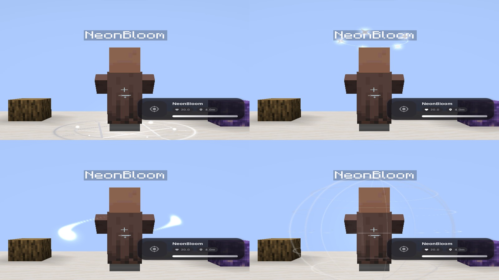
- 🖥️ **Nowe menu główne** (ekran po wczytaniu gry): wielki zegar na środku ekranu, logo i nick, a na dole rząd okrągłych przycisków-ikon: Singleplayer, Multiplayer, Realms, Opcje, ClickGUI i Wyjście. Animowane, dymne tło z cząsteczkami

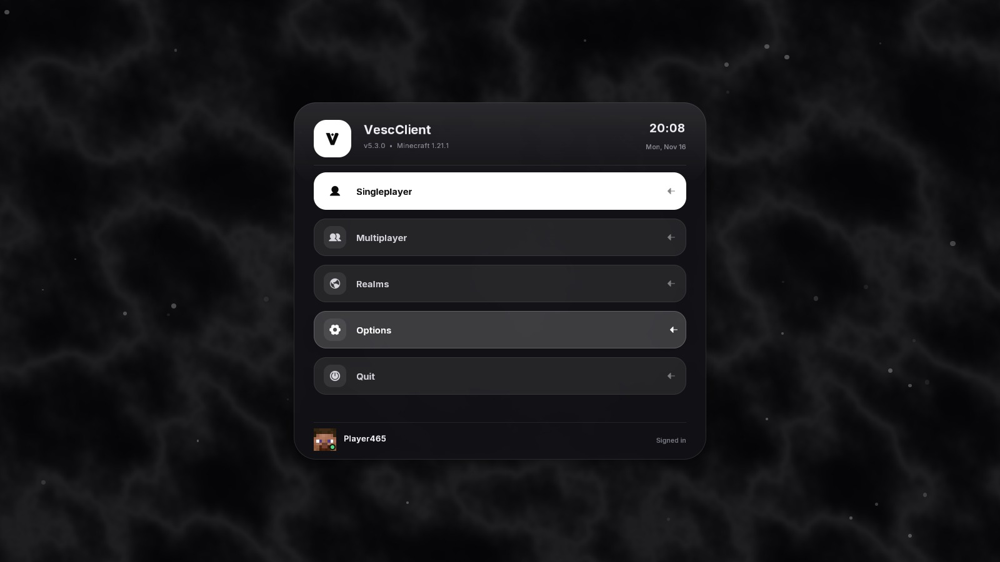

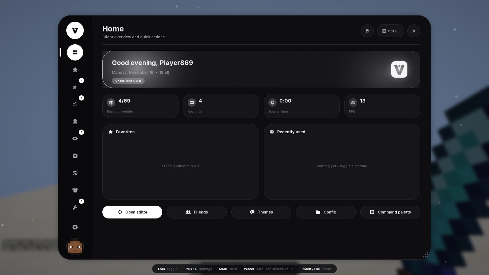
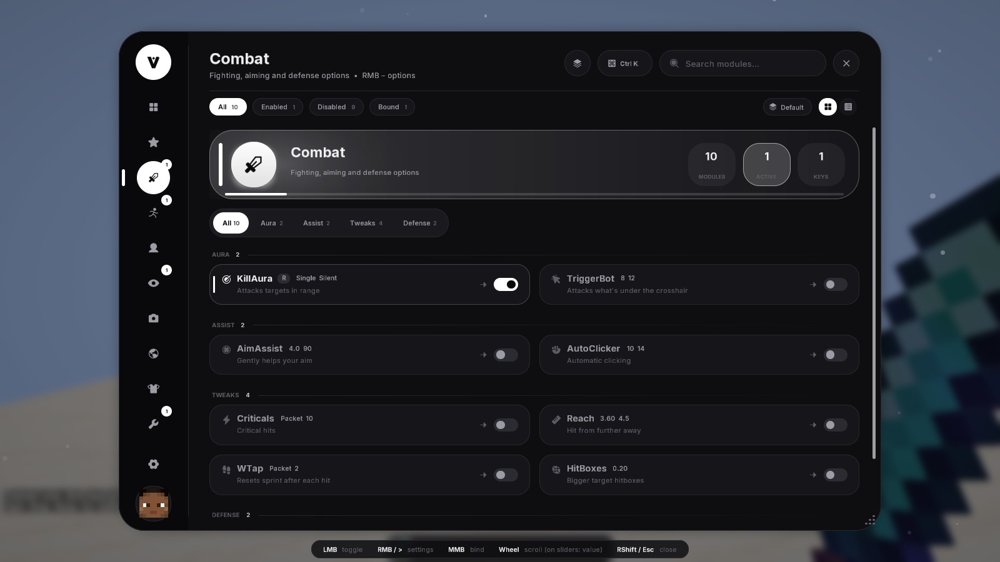

## Co nowego w 5.2

- ⚫⚪ **Motyw biało-czarny (MONO) domyślnie:** czyste, monochromatyczne GUI i HUD – białe akcenty na ciemnym tle, bez kolorów. Kolory wracają po wybraniu innego akcentu w Motywach (fiolet, niebieski, zielony…)
- 🟤 **Kategorie w czerni i bieli:** nagłówek kategorii, kafelki w menu bocznym i zakładki podgrup są monochromatyczne, gdy akcent to MONO (zachowują kontrast – ikona na białym kaflu jest czarna)
- ⭕ **Mocniejsze zaokrąglenia** w całym GUI i HUD (okno, karty, pigułki, panele HUD)
- 🧰 **Wybór elementów w edytorze HUD:** w edytorze (Open editor / strona HUD) jest lista **Elementy HUD** z przełącznikiem przy każdym elemencie (Watermark, KeyBindy, Powiadomienia, TargetHUD, Zegar…). Włączasz, co chcesz, i przeciągasz w dowolne miejsce ekranu

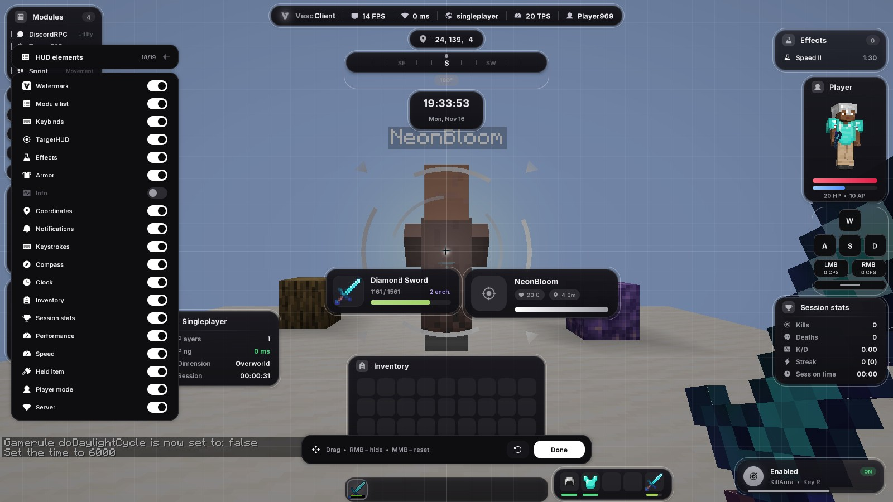

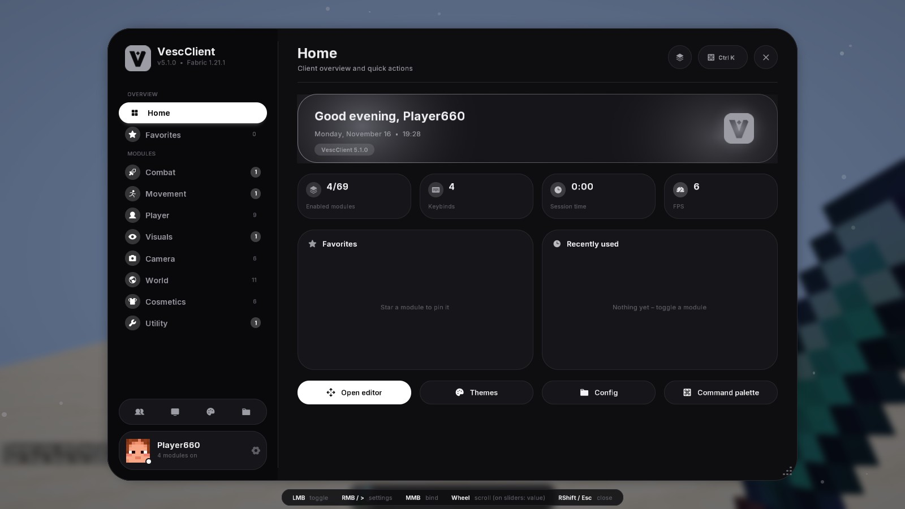
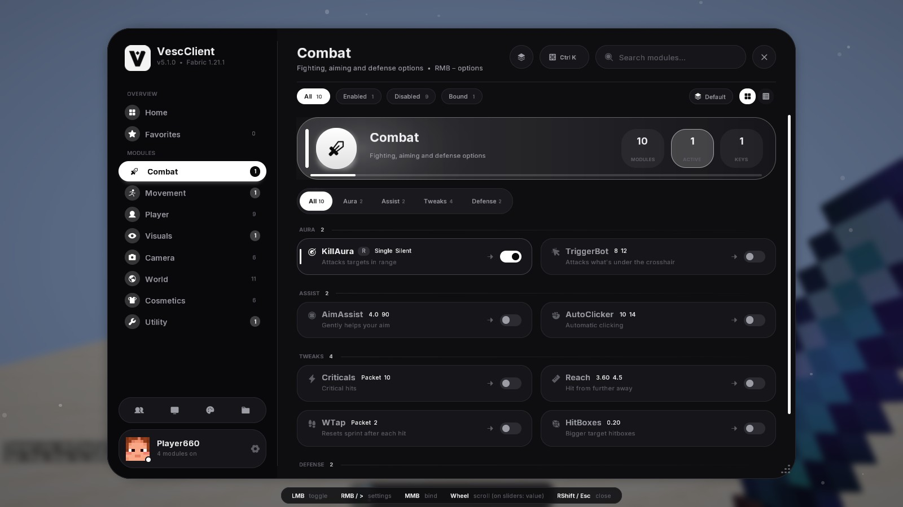
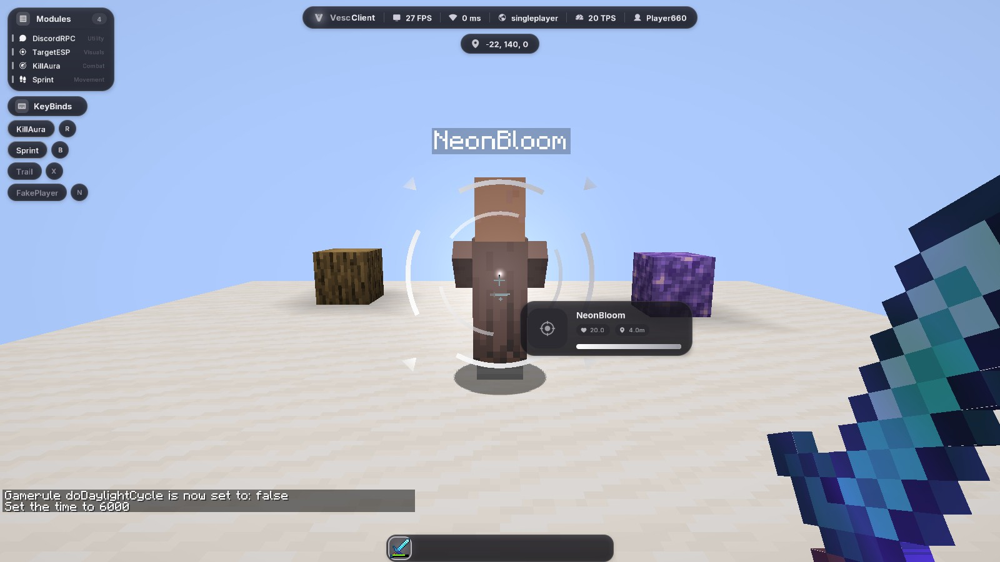

## Co nowego w 5.1

- 🪟 **Proste GUI:** domyślnie zwykłe, wyśrodkowane okno. Widok 3D (panel z boku) można włączyć w Ustawieniach → Układ GUI
- 🎯 **4 nowe tryby Target ESP:** **Reticle** (celownik „lock-on” z obracającymi się segmentami i strzałkami, które zbiegają się przy trafieniu), **Gyro** (żyroskop z 3 pierścieni), **Aura** (świecąca kolumna z iskrami) i **Souls** (świetliki z długimi ogonami). Razem 17 trybów, wszystkie z testem głębi (nie widać ich przez ściany)
- 🎮 **Discord Rich Presence:** gdy grasz, na profilu Discord widać logo VescClient, nazwę, wersję, plakietkę (np. Premium), serwer, czas gry i opcjonalny przycisk. Działa bez dodatkowych bibliotek (IPC Discorda: Windows, Linux, macOS)

- 🧩 **Nowe ikony:** pełne, wypełnione ikony (Phosphor Fill, MIT) zamiast cienkich konturów – czytelniejsze w małym rozmiarze

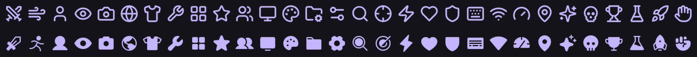

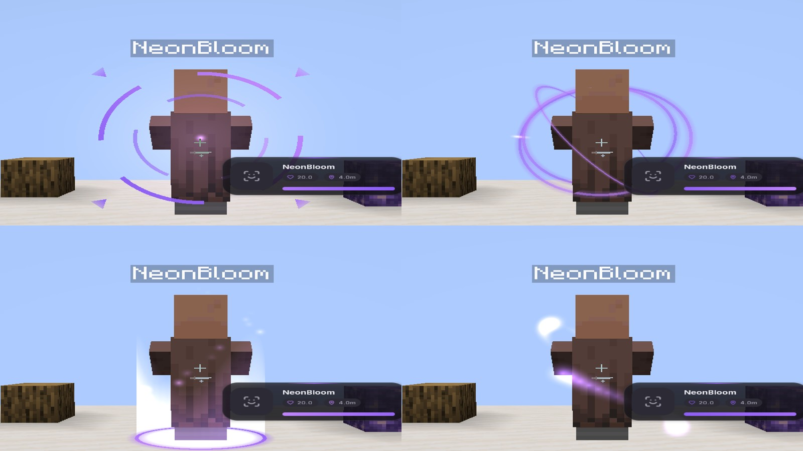

| | |
|---|---|
| 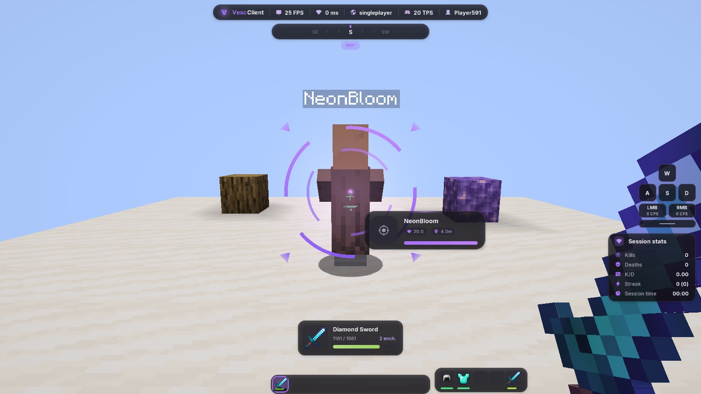 | 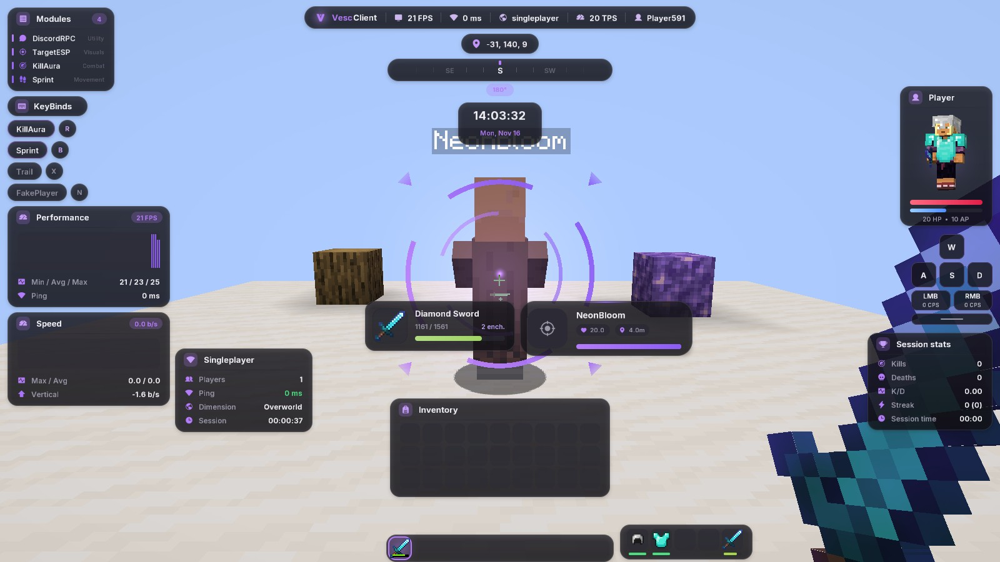 |

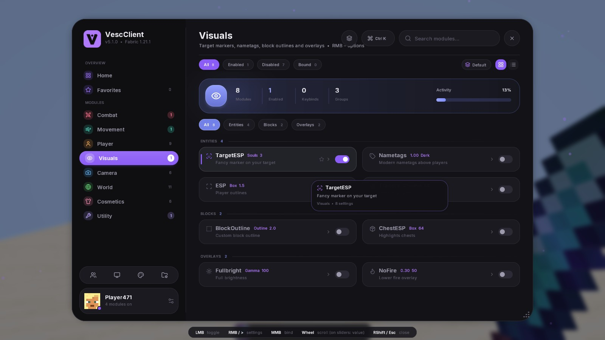

### Discord – konfiguracja (2 minuty)

1. Wejdź na https://discord.com/developers/applications → **New Application**. Nazwa aplikacji to pogrubiony tytuł w statusie, np. `VescClient (5.1)`
2. **Rich Presence → Art Assets** → wgraj `docs/discord_logo.png` (1024×1024) pod nazwą **`logo`**
3. Skopiuj **Application ID** i wklej do `.minecraft/vescclient/discord.json` w pole `appId` (plik tworzy się sam przy pierwszym uruchomieniu)
4. Opcjonalnie przycisk: `buttonLabel` (np. `Discord`) i `buttonUrl` (link zaczynający się od `https://`)
5. W Discordzie: Ustawienia → Prywatność aktywności → włącz udostępnianie aktywności

Moduł **DiscordRPC** (Utility) jest domyślnie włączony. Ma ustawienia: plakietka (Premium / Beta / Free / brak), duży obraz (logo lub skin), pokazywanie serwera, nicku i czasu.

## Co nowego w 5.0

- 💜 **Nowa marka VescClient:** własne logo (geometryczne „V” z iskrą), ikona moda, peleryny, motyw **Charcoal** (grafit) z akcentem **Violet**
- 🧊 **GUI przestrzenne (3D, opcjonalne):** po otwarciu w świecie kamera przechodzi do trzeciej osoby i odsuwa się w bok, postać stoi po lewej, a okno GUI unosi się po prawej jako przechylony panel w perspektywie. GUI jest najpierw rysowane płasko (ostre co do piksela), potem nakładane jako panel 3D. Kliknięcia są przeliczane odwrotną homografią, więc działają w każdym miejscu panelu. Układ można zmienić w Ustawieniach (3D / Window / Panels)
- 💊 **HUD „Vesc”:** Watermark na środku u góry (logo • FPS • ping • serwer • **TPS** • nick), pigułka z koordynatami, Keybinds jako osobne pigułki modułu i klawisza, zaokrąglony hotbar z płynnie przesuwanym zaznaczeniem, panele i powiadomienia w tym samym stylu
- ⚔️ **SwordAnimations:** 6 animacji machnięcia mieczem z pierwszej osoby (Smooth, Slide, Swipe, Stab, Spin, Chop) z regulacją siły
- 🎯 Render bez artefaktów z 4.0: shadery SDF, wygładzony tekst i ikony, linie dociągnięte do pikseli


| | |
|---|---|
|  | 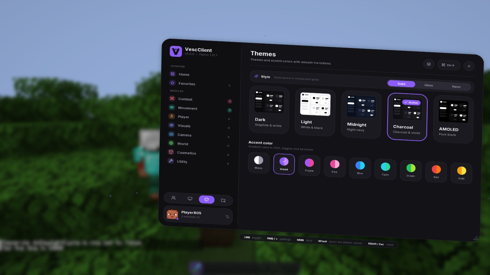 |

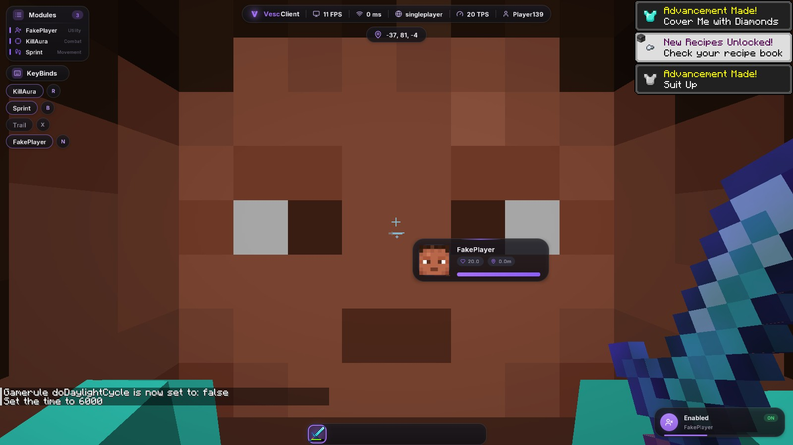

## Struktura kodu

Każdy moduł ma własny plik w folderze swojej kategorii:

```
src/main/java/dev/vesc/client/
├─ VescClient.java            klasa główna
├─ module/
│  ├─ Module.java, Category.java, ModuleManager.java (rejestr), Legit.java (logika modułów legit)
│  ├─ combat/     KillAura, TriggerBot, AimAssist, AutoClicker, Criticals, Reach, WTap, HitBoxes, Velocity, AutoTotem
│  ├─ movement/   Sprint, Speed, Step, NoFall, Flight, LongJump, AirJump, ElytraBoost, Spider, Jesus
│  ├─ player/     AutoArmor, InvManager, ChestStealer, AutoTool, FastPlace, FastUse, NoSlow, AutoEat, AutoRespawn
│  ├─ visuals/    TargetEsp, Nametags, ESP, Tracers, BlockOutline, ChestESP, Fullbright, NoFire
│  ├─ camera/     Zoom, FreeLook, Crosshair, ViewModel, SwordAnimations, NoHurtCam
│  ├─ world/      Sky, Ambient, TimeChanger, Weather, Scaffold, Nuker, FastBreak, LiquidPlace, AutoSign, AutoFarm, Timer
│  ├─ cosmetics/  Cosmetic, ChinaHat, Trail, JumpCircles, ToolColor, HitSound
│  └─ utility/    AutoGG, ChatSuffix, MiddleClick, DiscordPresence, AutoReconnect, AntiAFK, AntiBot, NameProtect, FakePlayer
├─ ui/        ClickGui, HudEditor, MainMenu, Theme, Anim
├─ hud/       Hud (wszystkie elementy HUD), Notifications, Tps, …
├─ render/    R2D (shadery SDF), Fonts, TargetEspRenderer, NametagRenderer, SkyRenderer, …
├─ mixin/     mixiny Minecrafta
├─ config/    zapis ustawień i konfiguracji
├─ setting/   BoolSetting, NumberSetting, ModeSetting, ColorSetting
└─ lang/      tłumaczenia PL / EN
```

Moduły typu cheat (combat, movement poza Sprint, ESP/Tracers/ChestESP, Scaffold, Nuker…) to **atrapy** – mają tylko ustawienia w GUI (opis w komentarzu klasy), bez logiki w grze.

## Budowanie

Wymagana Java 21.

```
./gradlew build        # Windows: gradlew.bat build
```

Gotowy plik: `build/libs/vescclient-5.3.0.jar` – wrzuć go do folderu `mods` razem z **Fabric API** (Minecraft 1.21.1, Fabric Loader 0.16.14+).
Testowe uruchomienie gry: `./gradlew runClient`.

## Sterowanie

- **Prawy Shift** – ClickGUI, **Ctrl+K** – paleta komend
- **LPM** na module – włącz/wyłącz, **PPM** – ustawienia, **ŚPM** – przypisz klawisz
- Edytor HUD: strona HUD w GUI – przeciąganie elementów, presety, style HUD (Vesc / Glass / Neon / Minimal)
