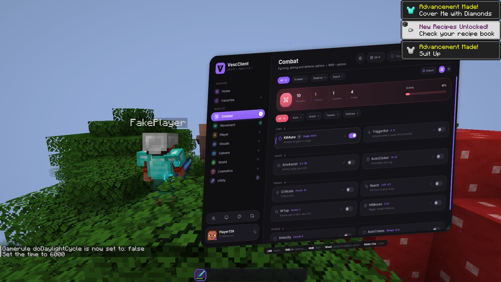
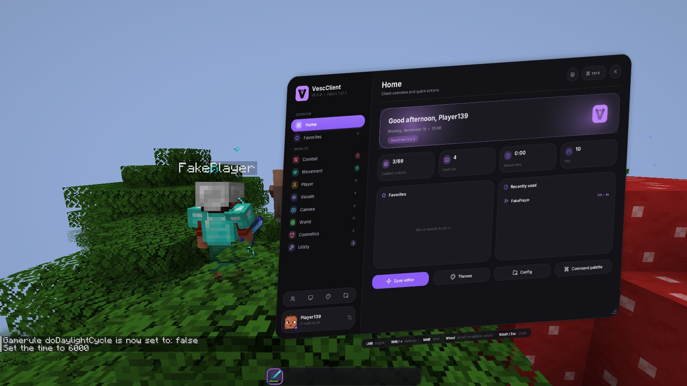

<p align="center"></p>

# VescClient 5.0

Nowoczesny klient do Minecraft **1.21.1 (Fabric)** z przestrzennym (3D) ClickGUI, HUD-em w stylu „pigułek”, motywami i modułami wizualnymi.

Działają moduły **kosmetyczne i legit** (wszystko po stronie klienta, bez przewagi nad innymi graczami):

- **Visuals:** TargetESP, Nametags (bez widzenia przez ściany), BlockOutline, Fullbright, NoFire
- **Camera:** Zoom (C, kółko myszy zmienia przybliżenie), FreeLook (lewy Alt), Crosshair, ViewModel, **SwordAnimations**, NoHurtCam
- **World:** Sky, Ambient, TimeChanger, Weather (tylko u Ciebie)
- **Cosmetics:** Cosmetic (peleryny z logo VescClient), ChinaHat, Trail, JumpCircles, ToolColor (kolor mieczy i narzędzi), HitSound
- **Utility:** NameProtect, AutoGG, ChatSuffix, MiddleClick (znajomi), AutoReconnect, FakePlayer
- **Movement / Player:** Sprint, AutoRespawn

Moduły typu cheat (KillAura, Reach, Velocity, Speed, Flight, Scaffold, ESP/Tracers/ChestESP, Nuker, AutoClicker itd.) są **przełącznikami bez logiki w grze**.

## Co nowego w 5.0

- 💜 **Nowa marka VescClient:** własne logo (geometryczne „V” z iskrą), ikona moda, peleryny, motyw **Charcoal** (grafit) z akcentem **Violet**
- 🧊 **GUI przestrzenne (3D):** po otwarciu w świecie kamera przechodzi do trzeciej osoby i odsuwa się w bok, postać stoi po lewej, a okno GUI unosi się po prawej jako przechylony panel w perspektywie. GUI jest najpierw rysowane płasko (ostre co do piksela), potem nakładane jako panel 3D. Kliknięcia są przeliczane odwrotną homografią, więc działają w każdym miejscu panelu. Układ można zmienić w Ustawieniach (3D / Window / Panels)
- 💊 **HUD „Vesc”:** Watermark na środku u góry (logo • FPS • ping • serwer • **TPS** • nick), pigułka z koordynatami, Keybinds jako osobne pigułki modułu i klawisza, zaokrąglony hotbar z płynnie przesuwanym zaznaczeniem, panele i powiadomienia w tym samym stylu
- ⚔️ **SwordAnimations:** 6 animacji machnięcia mieczem z pierwszej osoby (Smooth, Slide, Swipe, Stab, Spin, Chop) z regulacją siły
- 🎯 Render bez artefaktów z 4.0: shadery SDF, wygładzony tekst i ikony, linie dociągnięte do pikseli



| | |
|---|---|
|  |  |


## Budowanie

Wymagana Java 21.

```
./gradlew build        # Windows: gradlew.bat build
```

Gotowy plik: `build/libs/vescclient-5.0.0.jar` – wrzuć go do folderu `mods` razem z **Fabric API** (Minecraft 1.21.1, Fabric Loader 0.16.14+).
Testowe uruchomienie gry: `./gradlew runClient`.

## Sterowanie

- **Prawy Shift** – ClickGUI, **Ctrl+K** – paleta komend
- **LPM** na module – włącz/wyłącz, **PPM** – ustawienia, **ŚPM** – przypisz klawisz
- Edytor HUD: strona HUD w GUI – przeciąganie elementów, presety, style HUD (Vesc / Glass / Neon / Minimal)
